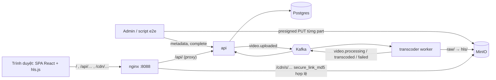

# Kiến trúc

## Tổng quan

Modular monolith + worker qua Kafka: `api`, `transcoder`, `analytics` (M6). Video không đi qua `api`: upload thẳng lên storage bằng presigned URL, phát thẳng từ CDN.



Phần đã chạy tới M4: `api` (đăng ký/đăng nhập, catalog, tìm kiếm không dấu và `/play` cho người xem, upload và danh sách video cho admin, consumer trạng thái, job dọn upload bỏ dở), `transcoder worker`, Postgres, Kafka, MinIO, nginx (cổng vào duy nhất: SPA, proxy API, CDN ký URL), web người xem `web/app`. Chưa có: xem tiếp, poster/sprite và phụ đề (M5), analytics (M6), trang admin (M7).

## api

| Module | Trách nhiệm (tới M4) |
|---|---|
| `internal/upload` | `POST /api/admin/videos` (tạo video, mở multipart upload, trả presigned URL), `/complete`, `/retry`; job dọn upload bỏ dở quá 24 giờ |
| `internal/catalog` | Repository `videos` / `renditions`, máy trạng thái, `GET /api/admin/videos[/{id}]`, `GET /api/videos[/{id}]` (tìm kiếm `q`, lọc `genre`/`year`), `GET /api/genres` và `/play` cho người xem (chỉ video `ready`), consumer `video.processing` / `video.transcoded` / `video.failed` (group `api`) |
| `internal/auth` | Bảng `users`, bcrypt, JWT HS256 trong cookie `sf_session`, `/api/auth/register|login|logout`, `/api/me`, middleware `Authenticate` / `RequireUser` / `RequireAdmin`, lệnh `api seed-admin` |
| `internal/signing` | Ký đường dẫn `/cdn/s/{sig}/{exp}/hls/{id}/…` đúng công thức `secure_link_md5` của nginx; từ chối tên file không an toàn (rỗng, bắt đầu bằng `/`, chứa `..`, `?`, `#`, `\` hoặc khoảng trắng) |
| `internal/events` | Topic, schema JSON, producer/consumer franz-go |
| `internal/db`, `migrations/` | Kết nối pgx, migration SQL nhúng, chạy khi api khởi động |

Nếu consumer trạng thái của `api` lỗi không phục hồi được thì process thoát với mã khác 0 (compose `restart: unless-stopped` khởi động lại). Chỉ `api` ghi Postgres. Router chia ba nhóm: public (`/healthz`, `/api/auth/*`), user (`/api/me`, `/api/videos/*`, `/api/genres`; `RequireUser`, thiếu đăng nhập → `401`) và admin (`/api/admin/*`; `RequireAdmin`, thiếu đăng nhập → `401`, viewer → `403`). Middleware `Authenticate` chạy cho mọi request: đọc cookie `sf_session`, kiểm tra JWT và gắn user id + role vào context, không truy vấn DB ([ADR 0010](decisions/0010-jwt-cookie-session.md)).

## Transcoder

`transcoder worker` consume `video.uploaded` (group `transcoder`), xử lý tuần tự từng job:

1. Publish `video.processing`.
2. Tải `raw/{id}/source.{ext}` về thư mục tạm, chạy pipeline FFmpeg (bảng dưới), upload `hls/{id}/` (ghi đè, nên chạy lại là idempotent).
3. Publish `video.transcoded`, rồi mới commit offset.

Lỗi: thử lại sau 5 giây, 30 giây, 2 phút. Hết lượt, hoặc lỗi không thể sửa bằng thử lại (file không có video stream), thì publish `video.failed` và ghi `video.uploaded.dlq`, rồi commit. Khi nhận SIGTERM, FFmpeg bị huỷ, offset không commit, job được làm lại khi worker khởi động. Consumer của worker dùng `events.NewConsumerWithOpts` với `RebalanceTimeout` 30 phút và `SessionTimeout` 60 giây, để group không đá worker ra giữa một job dài. Message có `video_id` không phải UUID dạng chuẩn bị đưa vào DLQ với `attempts: 0`. Scale ngang bằng cách chạy thêm worker, tối đa 3 (số partition).

Chế độ `transcoder file -in … -id …` của M1 vẫn dùng được để thử nhanh không qua Kafka.

| Bước | Chi tiết |
|---|---|
| Probe | `ffprobe` lấy chiều cao, thời lượng, có audio hay không. Không có video thì báo lỗi |
| Chọn ladder | 1080p 5000k, 720p 2800k, 480p 1400k, 360p 800k. Không upscale; nguồn nhỏ hơn 360p vẫn ra 360p |
| Encode | Một lần chạy FFmpeg: `split` + `scale` cho mọi bậc, H.264 `veryfast` main, AAC stereo |
| Keyframe | `-force_key_frames expr:gte(t,n_forced*2)` và `-sc_threshold 0`: keyframe đúng mỗi 2 giây ở mọi bậc |
| Đóng gói | HLS VOD, segment 6 giây MPEG-TS, `master.m3u8` + `{bậc}/index.m3u8` |

## Ngữ nghĩa xử lý Kafka

- Key message là `video_id`, nên mọi sự kiện của một video nằm cùng partition và giữ thứ tự.
- Consumer (cả `api` và `transcoder`) tắt auto-commit, commit offset của từng record **sau khi** handler xử lý xong. Nếu handler lỗi (DB hoặc Kafka chập chờn), record đó được thử lại tại chỗ với giãn cách 1s → 30s; không bỏ qua, không làm crash process.
- Do đó giao nhận là *at-least-once*: handler phải idempotent. `api` bỏ qua sự kiện làm chuyển trạng thái không hợp lệ (ví dụ `video.transcoded` khi video đã `ready`).
- Ghi Postgres rồi publish Kafka là dual-write, chấp nhận ở MVP ([ADR 0007](decisions/0007-accept-dual-write.md)).

## Web người xem và nginx

`web/app` là SPA React 18 + Vite + TypeScript, router `react-router-dom`, player `hls.js` (Safari dùng HLS gốc). Trang: `/login`, `/register`, `/` (phim mới), `/search?q=&genre=` (debounce 300 ms, trạng thái nằm trên URL), `/videos/{id}` (chi tiết), `/watch/{id}` (player, tải lazy cùng hls.js). Poster là khối màu tạm tới M5.

nginx là cổng vào duy nhất ở http://localhost:8088 ([ADR 0011](decisions/0011-same-origin-nginx-gateway.md)): `/` phục vụ bản build của SPA (route không phải file → `index.html`), `/api/` proxy nguyên URI tới `api:8000`, `/cdn/` là CDN ký URL. Cùng origin nên cookie `sf_session` (HttpOnly) tự đi kèm mọi `fetch`, không cần CORS. Image `streamfilm-nginx:dev` build SPA trong Docker (`deploy/docker/nginx.Dockerfile`).

Player: gọi `/play`, nạp URL ký vào hls.js. Lỗi `403` (URL hết hạn hoặc sai) hay lỗi mạng fatal → `PlaybackSession.refresh()` gọi lại `/play` và phát tiếp từ `currentTime`; nhiều lỗi cùng lúc chỉ gọi `/play` một lần, quá 3 lần trong 60 giây thì báo lỗi (`web/app/src/player/recovery.ts`). Lỗi media fatal → `hls.recoverMediaError()` (lần 2 gọi thêm `swapAudioCodec()`, lần 3 báo lỗi; đếm lại khi phát tiến triển). Route tải lazy được bọc `ErrorBoundary` để chunk cũ sau khi deploy hiện nút "Tải lại" thay vì trang trắng.

## Tìm kiếm

`GET /api/videos?q=` tìm trên cột `videos.search` (tsvector của tiêu đề, trọng số A, và mô tả, trọng số B, đã bỏ dấu bằng `immutable_unaccent`, trigger cập nhật). Có kết quả full-text thì xếp theo `ts_rank`; không có thì dự phòng trigram `<%` trên tiêu đề đã bỏ dấu để chịu lỗi gõ. Lọc `genre`, `year`; chỉ video `ready`. Chi tiết và lý do: [ADR 0012](decisions/0012-search-unaccent-trigram.md).

## CDN và signed URL

`/api/videos/{id}/play` trả `CDN_BASE_URL + /cdn/s/{sig}/{exp}/hls/{id}/master.m3u8` (URL tuyệt đối; local `CDN_BASE_URL` trùng origin của web nên player tải cùng origin), với `exp` = now + 2 giờ và `sig` = base64url (không padding) của `MD5("{exp}/hls/{id}/ {CDN_SIGNING_SECRET}")`. Chữ ký phủ cả thư mục `/hls/{id}/`, nên playlist con và segment (đường dẫn tương đối trong playlist) dùng chung một chữ ký.

nginx (`deploy/nginx/templates/default.conf.template`) bắt `sig`, `exp`, `id`, `file` từ path, tính lại chữ ký bằng `secure_link_md5`, sai hoặc hết hạn trả `403`, đúng thì bỏ prefix chữ ký và proxy `/hls/{id}/{file}` tới MinIO kèm `proxy_cache` (cache key `{id}/{file}`, không chứa chữ ký nên mọi người xem dùng chung cache). Secret dùng chung giữa api và nginx qua biến `CDN_SIGNING_SECRET`; image nginx chèn biến vào template bằng envsubst khi khởi động. Test `internal/signing/nginx_test.go` chạy đúng template này trong container để chứng minh hai bên khớp. Vì sao MD5: [ADR 0009](decisions/0009-signed-url-secure-link-md5.md).

Giới hạn đã biết: bucket `hls` vẫn đọc ẩn danh trực tiếp trên MinIO (`localhost:9000`) trong dev, nên lớp ký chỉ có hiệu lực khi đi qua nginx ([ADR 0002](decisions/0002-dev-hls-bucket-read.md)).

## Bố cục storage

```
raw/{id}/source.{mp4|mov|mkv|webm}   (upload multipart từ client)
hls/{id}/master.m3u8
hls/{id}/{1080p|720p|480p|360p}/index.m3u8
hls/{id}/{1080p|720p|480p|360p}/seg_000.ts …
```

## Đối chiếu với kiến trúc Hygraph

| Hygraph | Streamfilm |
|---|---|
| Upload service (presigned) | module `upload` trong `api`, presigned multipart lên MinIO |
| Video Processing Service | `transcoder worker` |
| Message queue | Kafka KRaft 1 node, 7 topic tạo sẵn |
| Metadata DB | Postgres (`videos`, `renditions`) |
| S3 | MinIO |
| CDN + token auth | nginx `secure_link_md5` + `proxy_cache`, URL ký theo prefix `/hls/{id}/`, hạn 2 giờ |
| User/Auth service | module `auth` trong `api` (bcrypt, JWT trong cookie HttpOnly) |
| Search | Postgres full-text + `unaccent` + `pg_trgm` trong module `catalog` |
| Client apps (web) | SPA React + hls.js phục vụ bởi nginx cùng origin với API |
