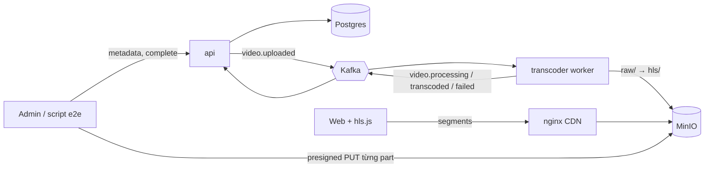

# Kiến trúc

## Tổng quan

Modular monolith + worker qua Kafka: `api`, `transcoder`, `analytics` (M6). Video không đi qua `api`: upload thẳng lên storage bằng presigned URL, phát thẳng từ CDN.



Phần đã chạy ở M2: `api` (upload, danh sách video cho admin, consumer trạng thái, job dọn upload bỏ dở), `transcoder worker`, Postgres, Kafka, MinIO, nginx. Chưa có: đăng nhập và signed URL (M3), web (M4), analytics (M6).

## api

| Module | Trách nhiệm ở M2 |
|---|---|
| `internal/upload` | `POST /api/admin/videos` (tạo video, mở multipart upload, trả presigned URL), `/complete`, `/retry`; job dọn upload bỏ dở quá 24 giờ |
| `internal/catalog` | Repository `videos` / `renditions`, máy trạng thái, `GET /api/admin/videos[/{id}]`, consumer `video.processing` / `video.transcoded` / `video.failed` (group `api`) |
| `internal/events` | Topic, schema JSON, producer/consumer franz-go |
| `internal/db`, `migrations/` | Kết nối pgx, migration SQL nhúng, chạy khi api khởi động |

Nếu consumer trạng thái của `api` lỗi không phục hồi được thì process thoát với mã khác 0 (compose `restart: unless-stopped` khởi động lại). Chỉ `api` ghi Postgres. Endpoint admin **chưa có auth** ở M2; M3 bọc nhóm `/api/admin` bằng middleware yêu cầu role `admin`.

## Transcoder

`transcoder worker` consume `video.uploaded` (group `transcoder`), xử lý tuần tự từng job:

1. Publish `video.processing`.
2. Tải `raw/{id}/source.{ext}` về thư mục tạm, chạy pipeline FFmpeg (bảng dưới), upload `hls/{id}/` (ghi đè, nên chạy lại là idempotent).
3. Publish `video.transcoded`, rồi mới commit offset.

Lỗi: thử lại sau 5 giây, 30 giây, 2 phút. Hết lượt, hoặc lỗi không thể sửa bằng thử lại (file không có video stream), thì publish `video.failed` và ghi `video.uploaded.dlq`, rồi commit. Khi nhận SIGTERM, FFmpeg bị huỷ, offset không commit, job được làm lại khi worker khởi động. Consumer của worker dùng `events.NewConsumerWithOpts` với `RebalanceTimeout` 30 phút và `SessionTimeout` 60 giây, để group không đá worker ra giữa một job dài. Message có `video_id` không phải UUID dạng chuẩn bị đưa vào DLQ với `attempts: 0`. Scale ngang bằng cách chạy thêm worker, tối đa 3 (số partition).

Chế độ `transcoder file -in … -id …` của M1 vẫn dùng được để thử nhanh không qua Kafka.

| Bước | Chi tiết |
|---|---|
| Probe | `ffprobe` lấy chiều cao, thời lượng, có audio hay không. Không có video thì báo lỗi |
| Chọn ladder | 1080p 5000k, 720p 2800k, 480p 1400k, 360p 800k. Không upscale; nguồn nhỏ hơn 360p vẫn ra 360p |
| Encode | Một lần chạy FFmpeg: `split` + `scale` cho mọi bậc, H.264 `veryfast` main, AAC stereo |
| Keyframe | `-force_key_frames expr:gte(t,n_forced*2)` và `-sc_threshold 0`: keyframe đúng mỗi 2 giây ở mọi bậc |
| Đóng gói | HLS VOD, segment 6 giây MPEG-TS, `master.m3u8` + `{bậc}/index.m3u8` |

## Ngữ nghĩa xử lý Kafka

- Key message là `video_id`, nên mọi sự kiện của một video nằm cùng partition và giữ thứ tự.
- Consumer (cả `api` và `transcoder`) tắt auto-commit, commit offset của từng record **sau khi** handler xử lý xong. Nếu handler lỗi (DB hoặc Kafka chập chờn), record đó được thử lại tại chỗ với giãn cách 1s → 30s; không bỏ qua, không làm crash process.
- Do đó giao nhận là *at-least-once*: handler phải idempotent. `api` bỏ qua sự kiện làm chuyển trạng thái không hợp lệ (ví dụ `video.transcoded` khi video đã `ready`).
- Ghi Postgres rồi publish Kafka là dual-write, chấp nhận ở MVP ([ADR 0007](decisions/0007-accept-dual-write.md)).

## Bố cục storage

```
raw/{id}/source.{mp4|mov|mkv|webm}   (upload multipart từ client)
hls/{id}/master.m3u8
hls/{id}/{1080p|720p|480p|360p}/index.m3u8
hls/{id}/{1080p|720p|480p|360p}/seg_000.ts …
```

## Đối chiếu với kiến trúc Hygraph

| Hygraph | Streamfilm |
|---|---|
| Upload service (presigned) | module `upload` trong `api`, presigned multipart lên MinIO |
| Video Processing Service | `transcoder worker` |
| Message queue | Kafka KRaft 1 node, 7 topic tạo sẵn |
| Metadata DB | Postgres (`videos`, `renditions`) |
| S3 | MinIO |
| CDN | nginx `proxy_cache` (ký URL từ M3) |
