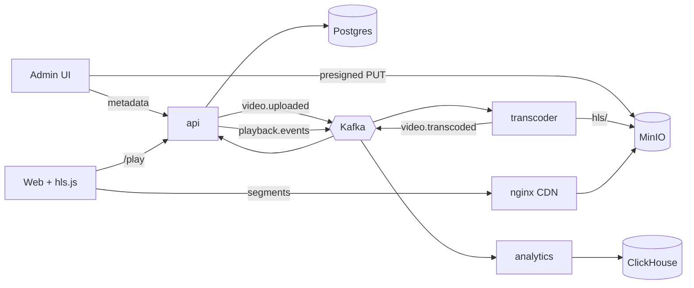

# Kiến trúc

## Tổng quan

Modular monolith + worker qua Kafka: `api` (chưa làm, M2–M3), `transcoder`, `analytics` (M6). Video không đi qua `api`: upload thẳng lên storage, phát thẳng từ CDN.



Phần đã chạy ở M1: `transcoder` (chế độ CLI), MinIO, nginx. Các phần còn lại có hạ tầng sẵn nhưng chưa có code.

## Transcoder

| Bước | Chi tiết |
|---|---|
| Probe | `ffprobe` lấy chiều cao, thời lượng, có audio hay không. Không có video thì báo lỗi |
| Chọn ladder | 1080p 5000k, 720p 2800k, 480p 1400k, 360p 800k. Không upscale; nguồn nhỏ hơn 360p vẫn ra 360p |
| Encode | Một lần chạy FFmpeg: `split` + `scale` cho mọi bậc, H.264 `veryfast` main, AAC stereo |
| Keyframe | `-force_key_frames expr:gte(t,n_forced*2)` và `-sc_threshold 0`: keyframe đúng mỗi 2 giây ở mọi bậc, nên ranh giới segment thẳng hàng và player đổi bậc không giật |
| Đóng gói | HLS VOD, segment 6 giây MPEG-TS, `master.m3u8` + `{bậc}/index.m3u8` |
| Upload | Toàn bộ thư mục lên bucket `hls` dưới prefix `{video_id}/` với Content-Type đúng |

## Bố cục storage

```
raw/{id}/source.mp4                 (từ M2)
hls/{id}/master.m3u8
hls/{id}/{1080p|720p|480p|360p}/index.m3u8
hls/{id}/{1080p|720p|480p|360p}/seg_000.ts …
```

## Đối chiếu với kiến trúc Hygraph

| Hygraph | Streamfilm |
|---|---|
| Video Processing Service | `transcoder` |
| S3 | MinIO |
| CDN | nginx `proxy_cache` (ký URL từ M3) |
| Kafka | Kafka KRaft 1 node, 7 topic tạo sẵn |
