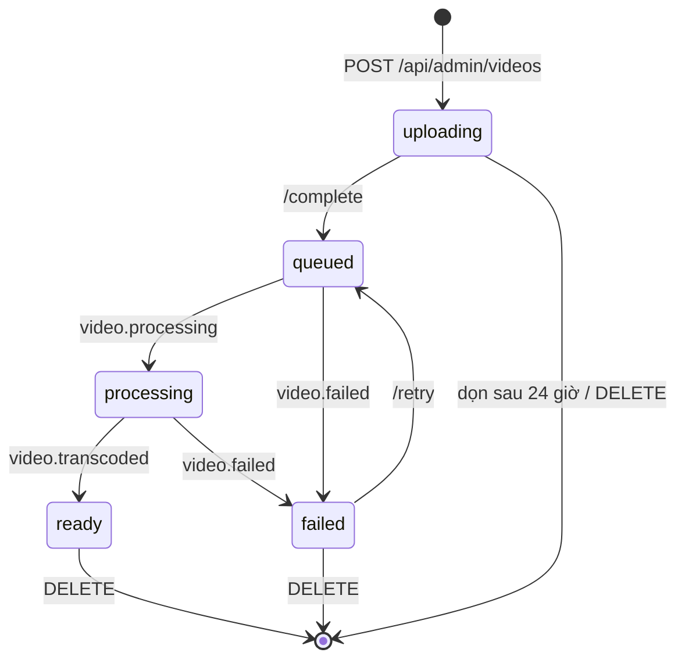

# Data model

## Postgres

Migration nằm trong `migrations/*.sql`, nhúng vào binary `api` và tự chạy khi khởi động (bảng `schema_migrations` ghi version đã áp, [ADR 0005](decisions/0005-embedded-migrations.md)):

| File | Giai đoạn | Nội dung |
|---|---|---|
| `0001_videos.sql` | M2 | `videos`, `renditions`, index theo `created_at` và `(status, created_at)` |
| `0002_users.sql` | M3 | `users` |
| `0003_search.sql` | M4 | extension `unaccent`, `pg_trgm`; hàm `immutable_unaccent`, `videos_search_tsv`; cột `videos.search` + trigger; index GIN |
| `0004_subtitles_progress.sql` | M5 | `subtitles`, `watch_progress` |

M7 không thêm migration: sửa metadata ghi các cột có sẵn, xoá video dựa vào `ON DELETE CASCADE` của các bảng con.

```sql
users (                    -- M3, migrations/0002_users.sql
  id uuid pk, email text unique check (email = lower(email)), password_hash text,  -- bcrypt cost 12
  role text check (role in ('admin','viewer')), created_at timestamptz
)
videos (
  id uuid pk, title text, description text, genres text[], year int,
  status text check (status in ('uploading','queued','processing','ready','failed')),
  fail_reason text,        -- lý do lỗi gần nhất, xoá khi ready
  duration_s int, raw_key text,
  upload_id text,          -- id multipart upload trên S3 (thêm so với spec)
  size_bytes bigint,       -- kích thước khai báo khi tạo, dùng tính số part (thêm so với spec)
  hls_prefix text, poster_key text, sprite_key text,
  search tsvector,         -- M4, migrations/0003_search.sql: unaccent(title) trọng số A + unaccent(description) B, trigger cập nhật
  created_at timestamptz, updated_at timestamptz
)
renditions (video_id uuid fk on delete cascade, height int, bitrate_kbps int, playlist_key text,
            pk(video_id, height))
-- M5, migrations/0004_subtitles_progress.sql
subtitles (video_id uuid fk on delete cascade, lang text, label text,
           vtt_key text,            -- {video_id}/subs/{lang}.vtt trong bucket hls
           created_at timestamptz, updated_at timestamptz, pk(video_id, lang))
watch_progress (user_id uuid fk on delete cascade, video_id uuid fk on delete cascade,
                position_s int check (>= 0), duration_s int check (>= 0),  -- duration_s chép từ videos lúc ghi
                updated_at timestamptz, pk(user_id, video_id))
```

`videos.poster_key` = `{id}/poster.jpg`, `videos.sprite_key` = `{id}/thumbnails.vtt` (chỉ mục các tấm sprite, [ADR 0013](decisions/0013-thumbnails-sprite-sheets.md)); `NULL` với video transcode trước M5.

Index: `videos(created_at desc)`, `videos(status, created_at)`, GIN `videos(search)`, GIN `pg_trgm` trên `immutable_unaccent(title)`, `watch_progress(user_id, updated_at desc)` (hàng "Xem tiếp").

Hàm (M4): `immutable_unaccent(text)` — bản `IMMUTABLE` của `unaccent` (extension `unaccent`, `pg_trgm`); `videos_search_tsv(title, description)`; trigger `videos_search_update` (`BEFORE INSERT OR UPDATE OF title, description`). Truy vấn tìm kiếm: [ADR 0012](decisions/0012-search-unaccent-trigram.md).

## Trạng thái video



`DELETE /api/admin/videos/{id}` (M7) không phải chuyển trạng thái mà xoá dòng; video `queued`/`processing` bị từ chối (`409`, [ADR 0020](decisions/0020-video-delete-and-edit.md)). `PATCH` không đổi `status`.

Mọi chuyển trạng thái đi qua `catalog.CanTransition` trong cùng transaction với `SELECT … FOR UPDATE`. Chuyển không hợp lệ (sự kiện trùng hoặc đến muộn) bị bỏ qua và ghi log. Một trường hợp đặc biệt: `video.processing` và `video.transcoded` nằm ở hai topic khác nhau nên `video.transcoded` có thể đến khi video còn `queued`; khi đó api đi `queued → processing → ready` (máy trạng thái không đổi). Ngoại lệ duy nhất: khi publish `video.uploaded` lỗi, `queued` được trả về trạng thái trước đó (bước bù trừ).

## Kafka

| Topic | Producer | Consumer group | Payload |
|---|---|---|---|
| `video.uploaded` | api | `transcoder` | `{"video_id","raw_key"}` |
| `video.uploaded.dlq` | transcoder | (xem bằng Redpanda Console) | `{"video_id","payload","error","attempts","failed_at"}` |
| `video.processing` | transcoder | `api` | `{"video_id"}` |
| `video.transcoded` | transcoder | `api` | `{"video_id","duration_s","hls_prefix","renditions":[{"height","bitrate_kbps","playlist_key"}],"poster_key","sprite_key"}` |
| `video.failed` | transcoder | `api` | `{"video_id","reason"}` |
| `playback.events` | api | `analytics-playback` | `{"ts","user_id","video_id","type","position_s","bitrate_kbps","buffering_ms"}` |
| `app.logs` | api, transcoder worker | `analytics-logs` | một dòng log JSON của `slog` (`time`, `level`, `msg`, `service`, `request_id`, `video_id`, …), không có key |

Key message = `video_id`, riêng `playback.events` key = `user_id` (giữ thứ tự sự kiện của một người xem). Mỗi topic 3 partition. `app.logs` có từ M6. `poster_key` / `sprite_key` có từ M5 (bỏ khỏi JSON khi rỗng).

Ví dụ `playback.events`:

```json
{"ts":"2026-11-15T10:05:00.123Z","user_id":"5f0c…","video_id":"7c1e…","type":"heartbeat",
 "position_s":12,"bitrate_kbps":2800,"buffering_ms":0}
```

Ví dụ `video.transcoded`:

```json
{"video_id":"7c1e…","duration_s":30,"hls_prefix":"7c1e…/","renditions":[
  {"height":1080,"bitrate_kbps":5000,"playlist_key":"7c1e…/1080p/index.m3u8"},
  {"height":720,"bitrate_kbps":2800,"playlist_key":"7c1e…/720p/index.m3u8"}],
 "poster_key":"7c1e…/poster.jpg","sprite_key":"7c1e…/thumbnails.vtt"}
```

Ví dụ `video.uploaded.dlq`:

```json
{"video_id":"7c1e…","payload":{"video_id":"7c1e…","raw_key":"7c1e…/source.mp4"},
 "error":"transcode: input has no video stream","attempts":1,"failed_at":"2026-11-14T10:00:00Z"}
```

Ví dụ `app.logs`:

```json
{"time":"2026-11-15T10:05:00.123Z","level":"INFO","msg":"http request","service":"api",
 "request_id":"3dff344481165cebcf48ff9be68dcea3","method":"GET","path":"/api/videos/7c1e…/play",
 "status":200,"duration_ms":4,"video_id":"7c1e…"}
```

## ClickHouse (M6)

Database `streamfilm`. `analytics` tạo bảng khi khởi động (`internal/analytics/schema.go`, idempotent):

```sql
CREATE TABLE IF NOT EXISTS playback_events (
  ts DateTime64(3, 'UTC'), user_id UUID, video_id UUID, type LowCardinality(String),
  position_s UInt32, bitrate_kbps UInt32, buffering_ms UInt32
) ENGINE = MergeTree ORDER BY (video_id, ts)
SETTINGS non_replicated_deduplication_window = 1000;

CREATE TABLE IF NOT EXISTS app_logs (
  ts DateTime64(3, 'UTC'), service LowCardinality(String), level LowCardinality(String),
  msg String, request_id String, video_id String, attrs String
) ENGINE = MergeTree ORDER BY (service, ts)
TTL toDateTime(ts) + INTERVAL 30 DAY
SETTINGS non_replicated_deduplication_window = 1000;
```

- `playback_events`: một row cho mỗi sự kiện của `playback.events`, `user_id`/`video_id` chữ thường. Có thể có row trùng khi analytics chết giữa INSERT và commit ([ADR 0017](decisions/0017-analytics-at-least-once.md)).
- `app_logs`: `time` của dòng log → `ts`; `level`, `msg`, `service`, `request_id`, `video_id` thành cột (thiếu thì chuỗi rỗng); mọi trường còn lại thành JSON trong `attrs` (đọc bằng `JSONExtractString(attrs, 'path')`, `JSONExtractInt(attrs, 'status')`…). Giữ 30 ngày.
- Giờ lưu UTC; analytics gửi dạng `YYYY-MM-DD hh:mm:ss.sss`.

SQL mẫu: `scripts/analytics/*.sql` (chạy bằng `make analytics-sql`, xem [operations](operations.md#analytics-và-log-m6)). `completion_rate.sql` gom theo (video, user) trước: người có `ended` nhưng mất `play` (best-effort) không được tính, nên tỉ lệ luôn trong [0, 1].

Xoá video (M7) không xoá row ClickHouse: lịch sử phân tích được giữ.
