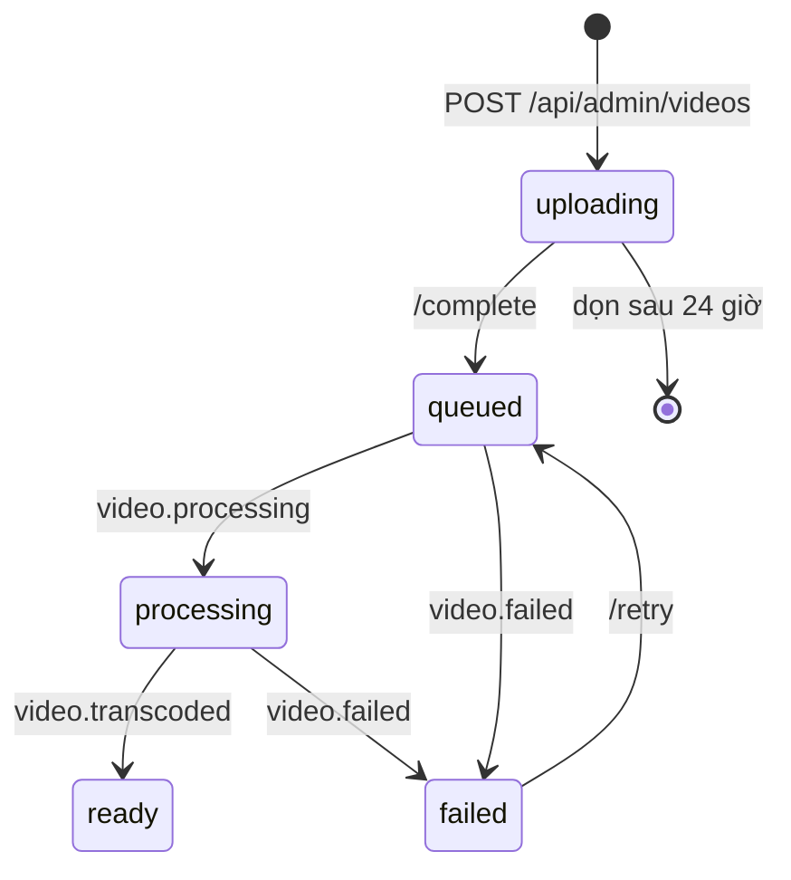

# Data model

## Postgres (tới M5)

Migration nằm trong `migrations/*.sql`, nhúng vào binary `api` và tự chạy khi khởi động (bảng `schema_migrations` ghi version đã áp).

```sql
users (                    -- M3, migrations/0002_users.sql
  id uuid pk, email text unique check (email = lower(email)), password_hash text,  -- bcrypt cost 12
  role text check (role in ('admin','viewer')), created_at timestamptz
)
videos (
  id uuid pk, title text, description text, genres text[], year int,
  status text check (status in ('uploading','queued','processing','ready','failed')),
  fail_reason text,        -- lý do lỗi gần nhất, xoá khi ready
  duration_s int, raw_key text,
  upload_id text,          -- id multipart upload trên S3 (thêm so với spec)
  size_bytes bigint,       -- kích thước khai báo khi tạo, dùng tính số part (thêm so với spec)
  hls_prefix text, poster_key text, sprite_key text,
  search tsvector,         -- M4, migrations/0003_search.sql: unaccent(title) trọng số A + unaccent(description) B, trigger cập nhật
  created_at timestamptz, updated_at timestamptz
)
renditions (video_id uuid fk on delete cascade, height int, bitrate_kbps int, playlist_key text,
            pk(video_id, height))
-- M5, migrations/0004_subtitles_progress.sql
subtitles (video_id uuid fk on delete cascade, lang text, label text,
           vtt_key text,            -- {video_id}/subs/{lang}.vtt trong bucket hls
           created_at timestamptz, updated_at timestamptz, pk(video_id, lang))
watch_progress (user_id uuid fk on delete cascade, video_id uuid fk on delete cascade,
                position_s int check (>= 0), duration_s int check (>= 0),  -- duration_s chép từ videos lúc ghi
                updated_at timestamptz, pk(user_id, video_id))
```

`videos.poster_key` = `{id}/poster.jpg`, `videos.sprite_key` = `{id}/thumbnails.vtt` (chỉ mục các tấm sprite, [ADR 0013](decisions/0013-thumbnails-sprite-sheets.md)); `NULL` với video transcode trước M5.

Index: `videos(created_at desc)`, `videos(status, created_at)`, GIN `videos(search)`, GIN `pg_trgm` trên `immutable_unaccent(title)`, `watch_progress(user_id, updated_at desc)` (hàng "Xem tiếp").

Hàm (M4): `immutable_unaccent(text)` — bản `IMMUTABLE` của `unaccent` (extension `unaccent`, `pg_trgm`); `videos_search_tsv(title, description)`; trigger `videos_search_update` (`BEFORE INSERT OR UPDATE OF title, description`). Truy vấn tìm kiếm: [ADR 0012](decisions/0012-search-unaccent-trigram.md).

## Trạng thái video



Mọi chuyển trạng thái đi qua `catalog.CanTransition` trong cùng transaction với `SELECT … FOR UPDATE`. Chuyển không hợp lệ (sự kiện trùng hoặc đến muộn) bị bỏ qua và ghi log. Một trường hợp đặc biệt: `video.processing` và `video.transcoded` nằm ở hai topic khác nhau nên `video.transcoded` có thể đến khi video còn `queued`; khi đó api đi `queued → processing → ready` (máy trạng thái không đổi). Ngoại lệ duy nhất: khi publish `video.uploaded` lỗi, `queued` được trả về trạng thái trước đó (bước bù trừ).

## Kafka

| Topic | Producer | Consumer group | Payload |
|---|---|---|---|
| `video.uploaded` | api | `transcoder` | `{"video_id","raw_key"}` |
| `video.uploaded.dlq` | transcoder | (xem bằng Redpanda Console) | `{"video_id","payload","error","attempts","failed_at"}` |
| `video.processing` | transcoder | `api` | `{"video_id"}` |
| `video.transcoded` | transcoder | `api` | `{"video_id","duration_s","hls_prefix","renditions":[{"height","bitrate_kbps","playlist_key"}],"poster_key","sprite_key"}` |
| `video.failed` | transcoder | `api` | `{"video_id","reason"}` |
| `playback.events` | api | (analytics, M6) | `{"ts","user_id","video_id","type","position_s","bitrate_kbps","buffering_ms"}` |

Key message = `video_id`, riêng `playback.events` key = `user_id` (giữ thứ tự sự kiện của một người xem). Mỗi topic 3 partition. `app.logs` đã tạo sẵn, dùng từ M6. `poster_key` / `sprite_key` có từ M5 (bỏ khỏi JSON khi rỗng).

Ví dụ `playback.events`:

```json
{"ts":"2026-11-15T10:05:00.123Z","user_id":"5f0c…","video_id":"7c1e…","type":"heartbeat",
 "position_s":12,"bitrate_kbps":2800,"buffering_ms":0}
```

Ví dụ `video.transcoded`:

```json
{"video_id":"7c1e…","duration_s":30,"hls_prefix":"7c1e…/","renditions":[
  {"height":1080,"bitrate_kbps":5000,"playlist_key":"7c1e…/1080p/index.m3u8"},
  {"height":720,"bitrate_kbps":2800,"playlist_key":"7c1e…/720p/index.m3u8"}],
 "poster_key":"7c1e…/poster.jpg","sprite_key":"7c1e…/thumbnails.vtt"}
```

Ví dụ `video.uploaded.dlq`:

```json
{"video_id":"7c1e…","payload":{"video_id":"7c1e…","raw_key":"7c1e…/source.mp4"},
 "error":"transcode: input has no video stream","attempts":1,"failed_at":"2026-11-14T10:00:00Z"}
```
