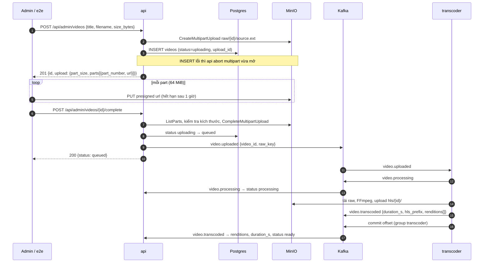
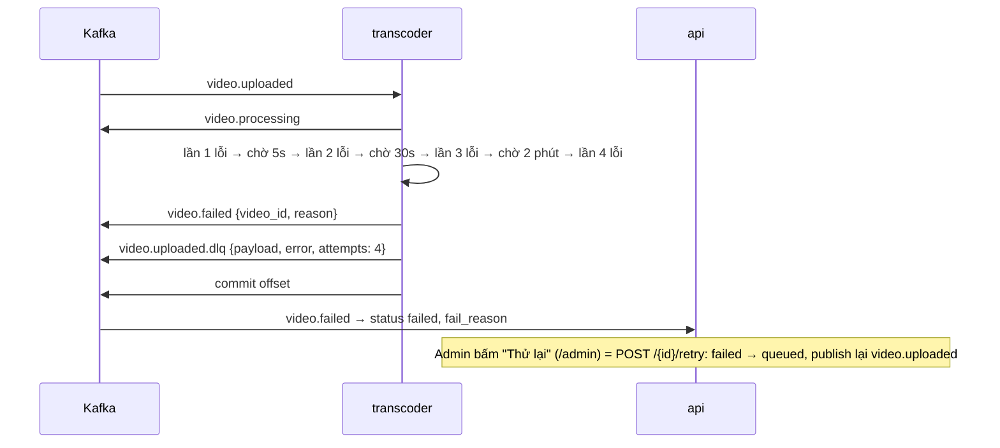
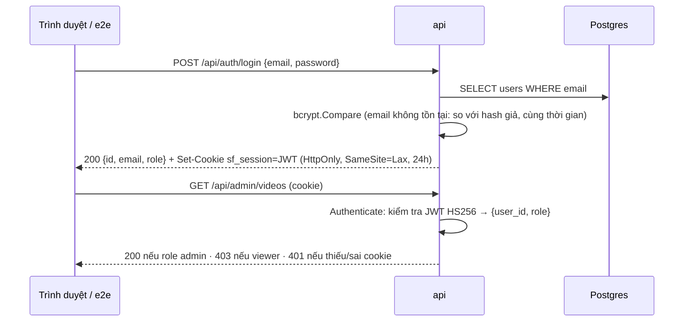
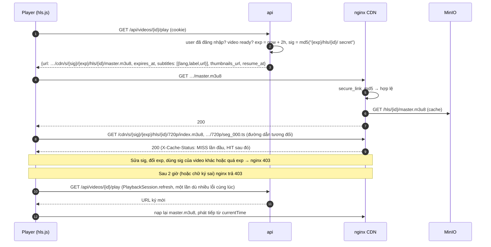

# Các luồng

Chỉ gồm các luồng đã chạy (tới M7).

## Upload và transcode



## Upload từ trang admin (M7)

```mermaid
sequenceDiagram
  autonumber
  participant B as Trình duyệt (/admin/upload)
  participant N as nginx (cổng 8088)
  participant API as api
  participant S3 as MinIO (cổng 9000)
  B->>N: POST /api/admin/videos {title, genres, year, filename, size_bytes} (cookie admin)
  N->>API: proxy
  API-->>B: 201 {id, upload: {part_size, parts[{part_number, url}]}}
  par tối đa 3 part cùng lúc
    B->>S3: OPTIONS presigned url (Origin: http://localhost:8088)
    S3-->>B: 204 Access-Control-Allow-Origin (MINIO_CORS_ALLOW_ORIGIN)
    B->>S3: PUT part (XMLHttpRequest, upload.onprogress → thanh tiến độ)
    Note over B,S3: lỗi mạng/5xx/408/429 → chờ 0,5 s, 1 s rồi thử lại, tối đa 3 lần/part (4xx khác không thử lại); hết lượt → huỷ các part đang gửi, cho admin xoá video dở; nút "Huỷ upload" cũng xoá video dở
  end
  B->>N: POST /api/admin/videos/{id}/complete
  N->>API: ListParts, CompleteMultipartUpload, queued, video.uploaded
  API-->>B: 200 {status: queued}
  B->>B: chuyển tới /admin/videos/{id}
  loop mỗi 3 giây khi queued/processing
    B->>N: GET /api/admin/videos/{id}
  end
  Note over B: ready → nút "Xem phim"; failed → fail_reason + nút "Thử lại"
```

ETag của từng part không cần đọc (api tự `ListParts`), nên MinIO không phải expose header nào ([ADR 0019](decisions/0019-admin-browser-upload.md)).

## Sửa và xoá video (M7)

```mermaid
sequenceDiagram
  participant A as Admin
  participant API as api
  participant PG as Postgres
  participant S3 as MinIO
  A->>API: PATCH /api/admin/videos/{id} {title?, description?, genres?, year?}
  API->>PG: SELECT video; gộp field; NormalizeMetadata
  API->>PG: UPDATE title, description, genres, year (trigger tính lại search)
  API-->>A: 200 video
  A->>API: DELETE /api/admin/videos/{id}
  API->>PG: BEGIN; SELECT … FOR UPDATE
  alt queued / processing
    API-->>A: 409 video is being processed
  else uploading / ready / failed
    API->>PG: DELETE videos (cascade renditions, subtitles, watch_progress); COMMIT
    API->>S3: AbortMultipartUpload (nếu uploading), xoá raw/{id}/, hls/{id}/ (lỗi chỉ log)
    API-->>A: 204
  end
```

## Retry và DLQ



Lỗi không sửa được bằng thử lại (file không có video stream) đi thẳng tới `video.failed` + DLQ với `attempts: 1`. Message hỏng (không phải JSON, thiếu `video_id`/`raw_key`, hoặc `video_id` không phải UUID dạng chuẩn) đi thẳng vào DLQ với `attempts: 0`.

## Kiểm tra kích thước khi complete

Trước khi ghép, api liệt kê part trên storage và kiểm tra: đủ part 1..N, mọi part trừ part cuối đúng 64 MiB, tổng kích thước đúng bằng `size_bytes` đã khai báo và không vượt 10 GB. Sai thì `/complete` trả `400` (ví dụ `multipart upload incomplete: uploaded 100 bytes, declared 200`), video vẫn `uploading`, client có thể upload lại part rồi gọi lại.

## Kafka không khả dụng khi complete

`/complete` đặt `queued` trước rồi publish (chờ tối đa 5 giây). Publish lỗi hoặc quá hạn thì video được trả về `uploading` và API trả `503` (đo thực tế: khoảng 5 giây); admin gọi lại `/complete` khi Kafka lên. Multipart đã ghép ở lần trước được nhận ra nhờ object `raw/{id}/source.ext` đã tồn tại. `/retry` xử lý tương tự (trả về `failed`).

## Dọn upload bỏ dở

Job trong `api` chạy lúc khởi động và mỗi `CLEANUP_INTERVAL` (mặc định 1 giờ): tìm video `uploading` tạo quá `STALE_UPLOAD_AFTER` (24 giờ), xoá dòng DB (chỉ khi vẫn còn `uploading`), rồi abort multipart upload và xoá object dưới `raw/{id}/`.

## Đăng nhập và phân quyền



Tài khoản admin đầu tiên: `make seed-admin` (chạy `api seed-admin` trong container, đọc `ADMIN_EMAIL` / `ADMIN_PASSWORD`; chạy lại thì đặt lại mật khẩu). `POST /api/auth/register` luôn tạo `viewer`.

## Xem phim với signed URL



Phụ đề (`…/subs/{lang}.vtt`, thẻ `<track>`), `thumbnails.vtt` và các tấm sprite cũng nằm dưới `/hls/{id}/` nên dùng chung chữ ký và cũng được lấy lại khi gọi lại `/play`.

Web gọi `/api/...` và tải `/cdn/...` qua cùng một origin (nginx `:8088`), nên cookie `sf_session` đi kèm request API mà không cần CORS ([ADR 0011](decisions/0011-same-origin-nginx-gateway.md)). Quá 3 lần lấy lại URL trong 60 giây thì player dừng và báo lỗi.

## Xem tiếp và sự kiện xem (M5)

```mermaid
sequenceDiagram
  autonumber
  participant P as Player (PlaybackReporter)
  participant API as api
  participant PG as Postgres
  participant K as Kafka
  participant H as Trang chủ
  P->>API: POST /api/playback/events {video_id, type: play, position_s, bitrate_kbps}
  API->>PG: video ready? (catalog.Repo.Get)
  API-)K: playback.events (nền, BestEffort, key user_id)
  API-->>P: 204
  loop mỗi 10 giây khi đang phát
    P->>API: heartbeat {position_s}
    API->>PG: UPSERT watch_progress (user_id, video_id, position_s, duration_s)
    API-)K: playback.events
    API-->>P: 204
  end
  Note over P,API: pause / ended cũng ghi watch_progress; seek / play / buffering chỉ vào Kafka
  Note over API,K: Kafka chết: publish hết 2 giây thì log và bỏ; quá 256 publish đang chờ thì bỏ ngay — request vẫn 204
  P->>API: rời trang (pagehide / chuyển trang): heartbeat vị trí cuối, fetch keepalive
  H->>API: GET /api/me/continue-watching
  API->>PG: watch_progress WHERE user_id AND 5% < pos/dur < 95% ORDER BY updated_at DESC LIMIT 20
  API->>PG: videos ready theo id (poster_url ký)
  API-->>H: {videos: [..., position_s, watched_at]}
  H->>API: bấm thẻ → /watch/{id} → GET /play
  API->>PG: resume_at = position_s (0 nếu ≥ 95%)
```

## Analytics và log (M6)

```mermaid
sequenceDiagram
  autonumber
  participant API as api / transcoder
  participant K as Kafka
  participant AN as analytics
  participant CH as ClickHouse
  API-)K: playback.events (BestEffort, M5)
  API-)K: app.logs — mỗi dòng slog (TryProduce, đầy thì bỏ)
  loop mỗi pipeline (analytics-playback, analytics-logs)
    AN->>K: PollRecords (tối đa 1000 - số record đang gom)
    Note over AN: record hỏng → bỏ qua, log "skip invalid record"
    alt đủ 1000 record hoặc 1 giây từ record đầu của lô
      AN->>CH: INSERT … FORMAT JSONEachRow (insert_deduplication_token = khoảng offset)
      alt ClickHouse lỗi
        AN->>AN: chờ 1s, 2s, 4s … 30s rồi gửi lại cùng lô, cùng token
      end
      AN->>K: CommitRecords (cả lô, kể cả record hỏng)
    end
  end
  Note over AN,K: SIGTERM: ghi nốt lô đang dở (tối đa 10 giây) rồi commit; không kịp thì không commit, lần sau đọc lại (SIGTERM giữa lúc INSERT thử lại: thử thêm đúng một lần với cùng lô và token)
```
