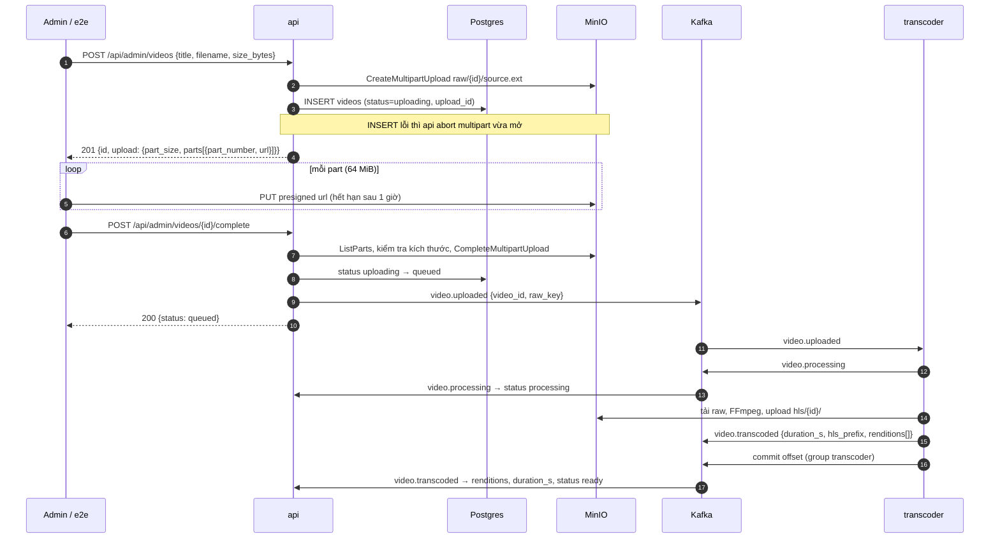
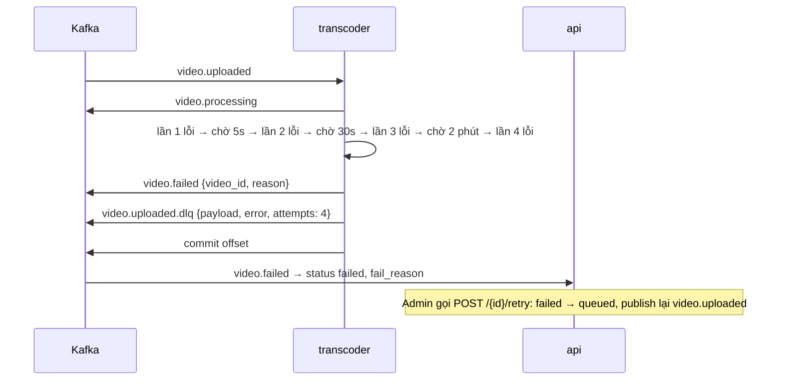

# Các luồng

Chỉ gồm các luồng đã chạy (M2). Luồng xem phim với signed URL, xem tiếp và analytics được thêm ở M3–M6.

## Upload và transcode

## Retry và DLQ

Lỗi không sửa được bằng thử lại (file không có video stream) đi thẳng tới `video.failed` + DLQ với `attempts: 1`. Message hỏng (không phải JSON, thiếu `video_id`/`raw_key`, hoặc `video_id` không phải UUID dạng chuẩn) đi thẳng vào DLQ với `attempts: 0`.

## Kiểm tra kích thước khi complete

Trước khi ghép, api liệt kê part trên storage và kiểm tra: đủ part 1..N, mọi part trừ part cuối đúng 64 MiB, tổng kích thước đúng bằng `size_bytes` đã khai báo và không vượt 10 GB. Sai thì `/complete` trả `400` (ví dụ `multipart upload incomplete: uploaded 100 bytes, declared 200`), video vẫn `uploading`, client có thể upload lại part rồi gọi lại.

## Kafka không khả dụng khi complete

`/complete` đặt `queued` trước rồi publish (chờ tối đa 5 giây). Publish lỗi hoặc quá hạn thì video được trả về `uploading` và API trả `503` (đo thực tế: khoảng 5 giây); admin gọi lại `/complete` khi Kafka lên. Multipart đã ghép ở lần trước được nhận ra nhờ object `raw/{id}/source.ext` đã tồn tại. `/retry` xử lý tương tự (trả về `failed`).

## Dọn upload bỏ dở

Job trong `api` chạy lúc khởi động và mỗi `CLEANUP_INTERVAL` (mặc định 1 giờ): tìm video `uploading` tạo quá `STALE_UPLOAD_AFTER` (24 giờ), xoá dòng DB (chỉ khi vẫn còn `uploading`), rồi abort multipart upload và xoá object dưới `raw/{id}/`.
