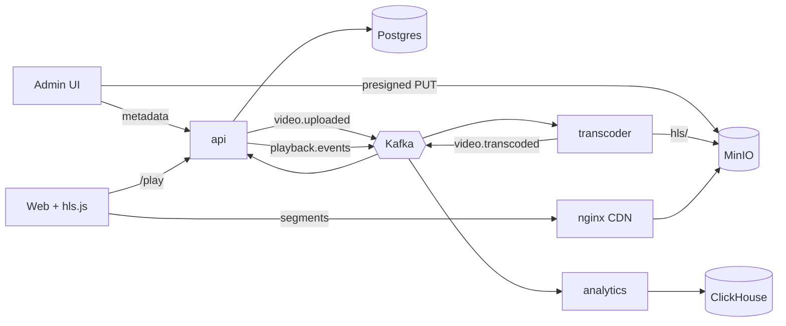

# Streamfilm M0 + M1: Hạ tầng và Transcode lõi — Implementation Plan

> **For agentic workers:** REQUIRED SUB-SKILL: Use superpowers:subagent-driven-development (recommended) or superpowers:executing-plans to implement this plan task-by-task. Steps use checkbox (`- [ ]`) syntax for tracking.

**Goal:** `make up` dựng đủ hạ tầng local, và lệnh `transcoder file -in movie.mp4 -id demo` biến một file mp4 thành HLS nhiều độ phân giải trên MinIO, phát được qua nginx bằng trang test hls.js.

**Architecture:** Repo Go một module (`streamfilm`). Package `internal/transcode` thuần (ladder, dựng tham số FFmpeg, parse ffprobe) cộng một runner gọi FFmpeg. Package `internal/storage` bọc S3 SDK. `cmd/transcoder` ở M1 chỉ có chế độ CLI `file`; chế độ consume Kafka thuộc M2. nginx proxy bucket `hls` (chưa ký URL, M3 mới thêm).

**Tech Stack:** Go 1.23+, aws-sdk-go-v2 (s3), testcontainers-go (module minio), FFmpeg/ffprobe, Docker Compose (postgres:16-alpine, minio, apache/kafka:3.8.0 KRaft, redpanda console, clickhouse 24.8, nginx 1.27), hls.js 1.5.17.

**Spec:** `docs/superpowers/specs/2026-11-14-streamfilm-vod-mvp-design.md`

## Global Constraints

- Go module path: `streamfilm`. Go tối thiểu 1.23.
- Bucket: `raw` (file gốc), `hls` (đầu ra). Key đầu ra: `{video_id}/master.m3u8`, `{video_id}/{rung}/index.m3u8`, `{video_id}/{rung}/seg_%03d.ts`.
- Ladder: 1080p 5000 kbps, 720p 2800, 480p 1400, 360p 800. Bỏ bậc cao hơn chiều cao nguồn, luôn giữ ít nhất bậc thấp nhất.
- H.264 + AAC, keyframe cố định mỗi 2 giây, `-sc_threshold 0`, segment HLS 6 giây, `hls_playlist_type vod`.
- Kafka topics (tạo sẵn, 3 partition): `video.uploaded`, `video.uploaded.dlq`, `video.processing`, `video.transcoded`, `video.failed`, `playback.events`, `app.logs`. Tắt auto-create topic.
- Cổng local: Postgres 5432, MinIO API 9000, MinIO Console 9001, Kafka (host) 29092, Redpanda Console 8080, ClickHouse HTTP 8123, nginx "CDN" 8088. Mọi cổng bind `127.0.0.1`.
- Tài liệu tiếng Việt, cập nhật trong cùng giai đoạn với code (spec mục 11).
- Secrets lấy từ biến môi trường; `.env` không commit, chỉ commit `.env.example`.
- Integration test tự `t.Skip` khi thiếu Docker hoặc FFmpeg; `go test -short ./...` chỉ chạy unit test.

## File Structure

```
streamfilm/
  go.mod, go.sum
  Makefile
  .env.example
  README.md
  cmd/transcoder/main.go            # CLI: transcoder file -in -id
  internal/config/config.go         # đọc env → Config
  internal/config/config_test.go
  internal/transcode/ladder.go      # Rung, DefaultLadder, SelectRungs
  internal/transcode/ladder_test.go
  internal/transcode/ffmpeg.go      # Job, BuildArgs
  internal/transcode/ffmpeg_test.go
  internal/transcode/probe.go       # ProbeResult, ParseProbe, Probe
  internal/transcode/probe_test.go
  internal/transcode/runner.go      # Runner.Transcode
  internal/transcode/runner_test.go # integration (cần ffmpeg)
  internal/testutil/sample.go       # MakeSampleVideo
  internal/storage/s3.go            # Store: UploadDir, Download, EnsureBucket, ContentTypeFor
  internal/storage/s3_test.go       # unit + integration (testcontainers minio)
  deploy/docker-compose.yml
  deploy/nginx/default.conf
  web/dev/player.html               # trang test hls.js
  docs/architecture.md
  docs/operations.md
  docs/decisions/0001-modular-monolith-kafka.md
  docs/decisions/0002-dev-hls-bucket-read.md
```

---

### Task 1: Toolchain, Go module, Makefile

**Files:**
- Create: `go.mod`, `Makefile`, `.env.example`
- Modify: `.gitignore`

**Interfaces:**
- Produces: các target Make `up`, `down`, `logs`, `ps`, `test`, `test-short`, `build`, `sample`, `transcode` mà mọi task sau dùng.

- [ ] **Step 1: Cài Go và kiểm tra công cụ**

Run: `brew install go && go version && ffmpeg -version | head -1 && docker compose version`
Expected: `go version go1.23` trở lên, một dòng phiên bản ffmpeg, một dòng phiên bản Docker Compose.

- [ ] **Step 2: Khởi tạo module**

Run: `cd /Users/anhdobui/systemdesign101/streamfilm && go mod init streamfilm`
Expected: tạo `go.mod` với dòng `module streamfilm`.

- [ ] **Step 3: Viết `.env.example`**

```dotenv
# Copy thành .env rồi chỉnh nếu cần. Các giá trị dưới là mặc định cho môi trường local.
S3_ENDPOINT=http://localhost:9000
S3_REGION=us-east-1
S3_ACCESS_KEY=streamfilm
S3_SECRET_KEY=streamfilm-secret
S3_BUCKET_RAW=raw
S3_BUCKET_HLS=hls
CDN_BASE_URL=http://localhost:8088
POSTGRES_PASSWORD=streamfilm
FFMPEG_PATH=ffmpeg
FFPROBE_PATH=ffprobe
```

- [ ] **Step 4: Viết `Makefile`**

```makefile
COMPOSE := docker compose -f deploy/docker-compose.yml --env-file .env

.PHONY: env up down logs ps test test-short build sample transcode

env:
	@test -f .env || cp .env.example .env

up: env
	$(COMPOSE) up -d --wait

down:
	$(COMPOSE) down

logs:
	$(COMPOSE) logs -f --tail=100

ps:
	$(COMPOSE) ps

test:
	go test ./...

test-short:
	go test -short ./...

build:
	go build -o bin/transcoder ./cmd/transcoder

# Sinh video mẫu 30 giây 1080p có tiếng vào tmp/sample.mp4
sample:
	@mkdir -p tmp
	ffmpeg -hide_banner -y -f lavfi -i testsrc2=size=1920x1080:rate=30 \
	  -f lavfi -i sine=frequency=440:sample_rate=48000 -t 30 \
	  -c:v libx264 -pix_fmt yuv420p -c:a aac tmp/sample.mp4

# make transcode FILE=tmp/sample.mp4 ID=demo
transcode: build env
	set -a; . ./.env; set +a; ./bin/transcoder file -in $(FILE) -id $(ID)
```

- [ ] **Step 5: Cập nhật `.gitignore`**

```gitignore
.env
node_modules/
dist/
bin/
tmp/
.claude/settings.local.json
```

- [ ] **Step 6: Kiểm tra và commit**

Run: `make env && test -f .env && echo ok`
Expected: `ok`

```bash
git add go.mod Makefile .env.example .gitignore
git commit -m "chore: init Go module, Makefile and env template"
```

---

### Task 2: Hạ tầng Docker Compose

**Files:**
- Create: `deploy/docker-compose.yml`, `deploy/nginx/default.conf`

**Interfaces:**
- Consumes: biến từ `.env` (Task 1).
- Produces: các service `postgres`, `minio`, `minio-init`, `kafka`, `kafka-init`, `console`, `clickhouse`, `nginx` với cổng như Global Constraints. Bucket `raw`, `hls` tồn tại; `hls` đọc ẩn danh được. nginx phục vụ `/hls/` (proxy MinIO, có cache) và `/dev/` (file tĩnh từ `web/dev`).

- [ ] **Step 1: Viết `deploy/docker-compose.yml`**

```yaml
name: streamfilm

services:
  postgres:
    image: postgres:16-alpine
    environment:
      POSTGRES_USER: streamfilm
      POSTGRES_PASSWORD: ${POSTGRES_PASSWORD}
      POSTGRES_DB: streamfilm
    ports: ["127.0.0.1:5432:5432"]
    volumes: [pgdata:/var/lib/postgresql/data]
    healthcheck:
      test: ["CMD-SHELL", "pg_isready -U streamfilm"]
      interval: 5s
      retries: 20

  minio:
    image: minio/minio:RELEASE.2024-10-13T13-34-11Z
    command: server /data --console-address ":9001"
    environment:
      MINIO_ROOT_USER: ${S3_ACCESS_KEY}
      MINIO_ROOT_PASSWORD: ${S3_SECRET_KEY}
    ports: ["127.0.0.1:9000:9000", "127.0.0.1:9001:9001"]
    volumes: [miniodata:/data]
    healthcheck:
      test: ["CMD", "mc", "ready", "local"]
      interval: 5s
      retries: 20

  minio-init:
    image: minio/mc:RELEASE.2024-10-08T09-37-26Z
    depends_on:
      minio: { condition: service_healthy }
    entrypoint: >
      /bin/sh -c "
      mc alias set local http://minio:9000 ${S3_ACCESS_KEY} ${S3_SECRET_KEY} &&
      mc mb --ignore-existing local/${S3_BUCKET_RAW} &&
      mc mb --ignore-existing local/${S3_BUCKET_HLS} &&
      mc anonymous set download local/${S3_BUCKET_HLS}
      "
    restart: "no"

  kafka:
    image: apache/kafka:3.8.0
    environment:
      KAFKA_NODE_ID: 1
      KAFKA_PROCESS_ROLES: broker,controller
      KAFKA_LISTENERS: PLAINTEXT://:9092,CONTROLLER://:9093,HOST://:29092
      KAFKA_ADVERTISED_LISTENERS: PLAINTEXT://kafka:9092,HOST://localhost:29092
      KAFKA_LISTENER_SECURITY_PROTOCOL_MAP: CONTROLLER:PLAINTEXT,PLAINTEXT:PLAINTEXT,HOST:PLAINTEXT
      KAFKA_CONTROLLER_LISTENER_NAMES: CONTROLLER
      KAFKA_CONTROLLER_QUORUM_VOTERS: 1@kafka:9093
      KAFKA_INTER_BROKER_LISTENER_NAME: PLAINTEXT
      KAFKA_OFFSETS_TOPIC_REPLICATION_FACTOR: 1
      KAFKA_TRANSACTION_STATE_LOG_REPLICATION_FACTOR: 1
      KAFKA_TRANSACTION_STATE_LOG_MIN_ISR: 1
      KAFKA_AUTO_CREATE_TOPICS_ENABLE: "false"
    ports: ["127.0.0.1:29092:29092"]
    volumes: [kafkadata:/var/lib/kafka/data]
    healthcheck:
      test: ["CMD-SHELL", "/opt/kafka/bin/kafka-broker-api-versions.sh --bootstrap-server localhost:9092 > /dev/null"]
      interval: 10s
      retries: 20

  kafka-init:
    image: apache/kafka:3.8.0
    depends_on:
      kafka: { condition: service_healthy }
    entrypoint: >
      /bin/sh -c "
      for t in video.uploaded video.uploaded.dlq video.processing video.transcoded video.failed playback.events app.logs; do
        /opt/kafka/bin/kafka-topics.sh --bootstrap-server kafka:9092 --create --if-not-exists --topic $$t --partitions 3 --replication-factor 1;
      done
      "
    restart: "no"

  console:
    image: docker.redpanda.com/redpandadata/console:v2.7.2
    environment:
      KAFKA_BROKERS: kafka:9092
    ports: ["127.0.0.1:8080:8080"]
    depends_on:
      kafka: { condition: service_healthy }

  clickhouse:
    image: clickhouse/clickhouse-server:24.8
    environment:
      CLICKHOUSE_DB: streamfilm
      CLICKHOUSE_USER: streamfilm
      CLICKHOUSE_PASSWORD: ${POSTGRES_PASSWORD}
      CLICKHOUSE_DEFAULT_ACCESS_MANAGEMENT: 1
    ports: ["127.0.0.1:8123:8123"]
    volumes: [chdata:/var/lib/clickhouse]
    ulimits:
      nofile: { soft: 262144, hard: 262144 }
    healthcheck:
      test: ["CMD-SHELL", "wget -qO- http://localhost:8123/ping | grep -q Ok"]
      interval: 5s
      retries: 20

  nginx:
    image: nginx:1.27-alpine
    ports: ["127.0.0.1:8088:80"]
    volumes:
      - ./nginx/default.conf:/etc/nginx/conf.d/default.conf:ro
      - ../web/dev:/usr/share/nginx/html/dev:ro
    depends_on:
      minio: { condition: service_healthy }
    healthcheck:
      test: ["CMD-SHELL", "wget -qO- http://localhost/healthz | grep -q ok"]
      interval: 5s
      retries: 20

volumes:
  pgdata:
  miniodata:
  kafkadata:
  chdata:
```

- [ ] **Step 2: Viết `deploy/nginx/default.conf`**

```nginx
# "CDN" giả lập. M1: chưa ký URL. M3 sẽ thay location /hls/ bằng /cdn/s/{sig}/{exp}/hls/ + secure_link.
proxy_cache_path /var/cache/nginx/hls levels=1:2 keys_zone=hls:10m max_size=1g inactive=7d use_temp_path=off;

server {
    listen 80;

    location = /healthz { return 200 "ok\n"; }

    location /hls/ {
        proxy_pass http://minio:9000/hls/;
        proxy_cache hls;
        proxy_cache_valid 200 7d;
        proxy_cache_key $uri;
        add_header X-Cache-Status $upstream_cache_status always;
        add_header Access-Control-Allow-Origin * always;
    }

    location /dev/ {
        root /usr/share/nginx/html;
    }
}
```

- [ ] **Step 3: Tạo thư mục web/dev để mount không lỗi**

Run: `mkdir -p web/dev && touch web/dev/.gitkeep`

- [ ] **Step 4: Chạy hạ tầng**

Run: `make up && make ps`
Expected: `postgres`, `minio`, `kafka`, `console`, `clickhouse`, `nginx` ở trạng thái `healthy`/`running`; `minio-init` và `kafka-init` đã `exited (0)`.

- [ ] **Step 5: Kiểm tra từng thành phần**

Run:
```bash
curl -s http://localhost:8088/healthz
docker compose -f deploy/docker-compose.yml exec kafka /opt/kafka/bin/kafka-topics.sh --bootstrap-server localhost:9092 --list
curl -s http://localhost:8123/ping
docker compose -f deploy/docker-compose.yml exec minio mc ls local
```
Expected: `ok`; danh sách đủ 7 topic; `Ok.`; hai bucket `hls/` và `raw/`. Mở http://localhost:8080 thấy Redpanda Console với 7 topic.

- [ ] **Step 6: Commit**

```bash
git add deploy web/dev/.gitkeep
git commit -m "feat(deploy): docker compose infra with postgres, minio, kafka, clickhouse, nginx"
```

---

### Task 3: Package config

**Files:**
- Create: `internal/config/config.go`, `internal/config/config_test.go`

**Interfaces:**
- Produces:
  ```go
  type Config struct {
      S3Endpoint, S3Region, S3AccessKey, S3SecretKey string
      BucketRaw, BucketHLS                           string
      CDNBaseURL                                     string
      FFmpegPath, FFprobePath                        string
  }
  func Load() Config // đọc env, dùng mặc định khi thiếu
  ```

- [ ] **Step 1: Viết test thất bại**

```go
package config

import "testing"

func TestLoadDefaults(t *testing.T) {
	for _, k := range []string{"S3_ENDPOINT", "S3_BUCKET_HLS", "CDN_BASE_URL", "FFMPEG_PATH"} {
		t.Setenv(k, "")
	}
	c := Load()
	if c.S3Endpoint != "http://localhost:9000" {
		t.Errorf("S3Endpoint = %q", c.S3Endpoint)
	}
	if c.BucketHLS != "hls" || c.BucketRaw != "raw" {
		t.Errorf("buckets = %q %q", c.BucketRaw, c.BucketHLS)
	}
	if c.CDNBaseURL != "http://localhost:8088" {
		t.Errorf("CDNBaseURL = %q", c.CDNBaseURL)
	}
	if c.FFmpegPath != "ffmpeg" || c.FFprobePath != "ffprobe" {
		t.Errorf("ffmpeg paths = %q %q", c.FFmpegPath, c.FFprobePath)
	}
}

func TestLoadOverride(t *testing.T) {
	t.Setenv("S3_ENDPOINT", "http://minio:9000")
	t.Setenv("S3_BUCKET_HLS", "media")
	c := Load()
	if c.S3Endpoint != "http://minio:9000" || c.BucketHLS != "media" {
		t.Errorf("override not applied: %+v", c)
	}
}
```

- [ ] **Step 2: Chạy test, xác nhận thất bại**

Run: `go test ./internal/config/`
Expected: FAIL, `undefined: Load`

- [ ] **Step 3: Viết code**

```go
// Package config đọc cấu hình từ biến môi trường.
package config

import "os"

type Config struct {
	S3Endpoint, S3Region, S3AccessKey, S3SecretKey string
	BucketRaw, BucketHLS                           string
	CDNBaseURL                                     string
	FFmpegPath, FFprobePath                        string
}

func Load() Config {
	return Config{
		S3Endpoint:  get("S3_ENDPOINT", "http://localhost:9000"),
		S3Region:    get("S3_REGION", "us-east-1"),
		S3AccessKey: get("S3_ACCESS_KEY", "streamfilm"),
		S3SecretKey: get("S3_SECRET_KEY", "streamfilm-secret"),
		BucketRaw:   get("S3_BUCKET_RAW", "raw"),
		BucketHLS:   get("S3_BUCKET_HLS", "hls"),
		CDNBaseURL:  get("CDN_BASE_URL", "http://localhost:8088"),
		FFmpegPath:  get("FFMPEG_PATH", "ffmpeg"),
		FFprobePath: get("FFPROBE_PATH", "ffprobe"),
	}
}

func get(key, def string) string {
	if v := os.Getenv(key); v != "" {
		return v
	}
	return def
}
```

- [ ] **Step 4: Chạy test, xác nhận pass**

Run: `go test ./internal/config/`
Expected: `ok  	streamfilm/internal/config`

- [ ] **Step 5: Commit**

```bash
git add internal/config
git commit -m "feat(config): load settings from environment"
```

---

### Task 4: Ladder độ phân giải

**Files:**
- Create: `internal/transcode/ladder.go`, `internal/transcode/ladder_test.go`

**Interfaces:**
- Produces:
  ```go
  type Rung struct { Name string; Height, VideoKbps, AudioKbps int }
  var DefaultLadder []Rung // 1080p,720p,480p,360p theo thứ tự giảm dần
  func SelectRungs(ladder []Rung, sourceHeight int) []Rung
  ```

- [ ] **Step 1: Viết test thất bại**

```go
package transcode

import (
	"reflect"
	"testing"
)

func names(rs []Rung) []string {
	out := make([]string, len(rs))
	for i, r := range rs {
		out[i] = r.Name
	}
	return out
}

func TestSelectRungs(t *testing.T) {
	cases := []struct {
		src  int
		want []string
	}{
		{2160, []string{"1080p", "720p", "480p", "360p"}},
		{1080, []string{"1080p", "720p", "480p", "360p"}},
		{720, []string{"720p", "480p", "360p"}},
		{544, []string{"480p", "360p"}},
		{360, []string{"360p"}},
		{240, []string{"360p"}}, // nguồn nhỏ hơn mọi bậc: giữ bậc thấp nhất
	}
	for _, c := range cases {
		got := names(SelectRungs(DefaultLadder, c.src))
		if !reflect.DeepEqual(got, c.want) {
			t.Errorf("src=%d: got %v want %v", c.src, got, c.want)
		}
	}
}

func TestDefaultLadderBitrates(t *testing.T) {
	want := map[string]int{"1080p": 5000, "720p": 2800, "480p": 1400, "360p": 800}
	for _, r := range DefaultLadder {
		if want[r.Name] != r.VideoKbps {
			t.Errorf("%s: %d kbps, want %d", r.Name, r.VideoKbps, want[r.Name])
		}
	}
}
```

- [ ] **Step 2: Chạy test, xác nhận thất bại**

Run: `go test ./internal/transcode/ -run Ladder\|SelectRungs`
Expected: FAIL, `undefined: Rung`

- [ ] **Step 3: Viết code**

```go
// Package transcode biến một file video thành HLS nhiều độ phân giải.
package transcode

// Rung là một bậc chất lượng trong encoding ladder.
type Rung struct {
	Name      string // tên thư mục con, ví dụ "720p"
	Height    int
	VideoKbps int
	AudioKbps int
}

// DefaultLadder sắp theo chiều cao giảm dần.
var DefaultLadder = []Rung{
	{Name: "1080p", Height: 1080, VideoKbps: 5000, AudioKbps: 128},
	{Name: "720p", Height: 720, VideoKbps: 2800, AudioKbps: 128},
	{Name: "480p", Height: 480, VideoKbps: 1400, AudioKbps: 96},
	{Name: "360p", Height: 360, VideoKbps: 800, AudioKbps: 96},
}

// SelectRungs trả về các bậc không cao hơn nguồn (không upscale).
// Nếu nguồn thấp hơn mọi bậc thì giữ bậc thấp nhất.
func SelectRungs(ladder []Rung, sourceHeight int) []Rung {
	var out []Rung
	for _, r := range ladder {
		if r.Height <= sourceHeight {
			out = append(out, r)
		}
	}
	if len(out) == 0 && len(ladder) > 0 {
		out = []Rung{ladder[len(ladder)-1]}
	}
	return out
}
```

- [ ] **Step 4: Chạy test, xác nhận pass**

Run: `go test ./internal/transcode/`
Expected: `ok`

- [ ] **Step 5: Commit**

```bash
git add internal/transcode/ladder.go internal/transcode/ladder_test.go
git commit -m "feat(transcode): encoding ladder and rung selection"
```

---

### Task 5: Dựng tham số FFmpeg

**Files:**
- Create: `internal/transcode/ffmpeg.go`, `internal/transcode/ffmpeg_test.go`

**Interfaces:**
- Consumes: `Rung` (Task 4).
- Produces:
  ```go
  type Job struct {
      Input, OutDir   string
      Rungs           []Rung
      HasAudio        bool
      SegmentSeconds  int // 6
      KeyframeSeconds int // 2
  }
  func BuildArgs(j Job) []string // tham số cho ffmpeg (không gồm tên chương trình)
  ```

- [ ] **Step 1: Viết test thất bại**

```go
package transcode

import (
	"path/filepath"
	"strings"
	"testing"
)

// hasSeq kiểm tra args chứa đúng chuỗi liên tiếp seq.
func hasSeq(args []string, seq ...string) bool {
	for i := 0; i+len(seq) <= len(args); i++ {
		ok := true
		for j := range seq {
			if args[i+j] != seq[j] {
				ok = false
				break
			}
		}
		if ok {
			return true
		}
	}
	return false
}

func testJob(audio bool) Job {
	return Job{
		Input: "in.mp4", OutDir: "/out",
		Rungs:          SelectRungs(DefaultLadder, 720),
		HasAudio:       audio,
		SegmentSeconds: 6, KeyframeSeconds: 2,
	}
}

func TestBuildArgsWithAudio(t *testing.T) {
	a := BuildArgs(testJob(true))
	checks := [][]string{
		{"-i", "in.mp4"},
		{"-filter_complex", "[0:v]split=3[s0][s1][s2];[s0]scale=-2:720[v0];[s1]scale=-2:480[v1];[s2]scale=-2:360[v2]"},
		{"-map", "[v0]"}, {"-map", "[v2]"}, {"-map", "0:a:0"},
		{"-b:v:0", "2800k"}, {"-b:v:2", "800k"},
		{"-force_key_frames", "expr:gte(t,n_forced*2)"},
		{"-sc_threshold", "0"},
		{"-c:a", "aac"}, {"-b:a:1", "96k"},
		{"-hls_time", "6"}, {"-hls_playlist_type", "vod"},
		{"-master_pl_name", "master.m3u8"},
		{"-var_stream_map", "v:0,a:0,name:720p v:1,a:1,name:480p v:2,a:2,name:360p"},
		{"-hls_segment_filename", filepath.Join("/out", "%v", "seg_%03d.ts")},
	}
	for _, c := range checks {
		if !hasSeq(a, c...) {
			t.Errorf("missing %v in %s", c, strings.Join(a, " "))
		}
	}
	if a[len(a)-1] != filepath.Join("/out", "%v", "index.m3u8") {
		t.Errorf("last arg = %q", a[len(a)-1])
	}
}

func TestBuildArgsWithoutAudio(t *testing.T) {
	a := BuildArgs(testJob(false))
	if hasSeq(a, "-map", "0:a:0") || hasSeq(a, "-c:a", "aac") {
		t.Errorf("audio args present without audio: %v", a)
	}
	if !hasSeq(a, "-var_stream_map", "v:0,name:720p v:1,name:480p v:2,name:360p") {
		t.Errorf("bad var_stream_map: %v", a)
	}
}
```

- [ ] **Step 2: Chạy test, xác nhận thất bại**

Run: `go test ./internal/transcode/ -run BuildArgs`
Expected: FAIL, `undefined: Job`

- [ ] **Step 3: Viết code**

```go
package transcode

import (
	"fmt"
	"path/filepath"
	"strings"
)

// Job mô tả một lần transcode ra HLS.
type Job struct {
	Input, OutDir   string
	Rungs           []Rung
	HasAudio        bool
	SegmentSeconds  int
	KeyframeSeconds int
}

// BuildArgs dựng tham số FFmpeg cho một lần chạy sinh mọi bậc cùng lúc.
// Keyframe ép theo thời gian (không phụ thuộc fps) để mọi bậc có ranh giới
// segment thẳng hàng, giúp player đổi chất lượng không giật.
func BuildArgs(j Job) []string {
	n := len(j.Rungs)
	args := []string{"-hide_banner", "-y", "-i", j.Input}

	var split, scales strings.Builder
	split.WriteString(fmt.Sprintf("[0:v]split=%d", n))
	for i, r := range j.Rungs {
		split.WriteString(fmt.Sprintf("[s%d]", i))
		scales.WriteString(fmt.Sprintf(";[s%d]scale=-2:%d[v%d]", i, r.Height, i))
	}
	args = append(args, "-filter_complex", split.String()+scales.String())

	for i := range j.Rungs {
		args = append(args, "-map", fmt.Sprintf("[v%d]", i))
	}
	if j.HasAudio {
		for range j.Rungs {
			args = append(args, "-map", "0:a:0")
		}
	}

	for i, r := range j.Rungs {
		args = append(args,
			fmt.Sprintf("-c:v:%d", i), "libx264",
			fmt.Sprintf("-b:v:%d", i), fmt.Sprintf("%dk", r.VideoKbps),
			fmt.Sprintf("-maxrate:v:%d", i), fmt.Sprintf("%dk", r.VideoKbps*107/100),
			fmt.Sprintf("-bufsize:v:%d", i), fmt.Sprintf("%dk", r.VideoKbps*3/2),
		)
	}
	args = append(args,
		"-preset", "veryfast",
		"-profile:v", "main",
		"-pix_fmt", "yuv420p",
		"-sc_threshold", "0",
		"-force_key_frames", fmt.Sprintf("expr:gte(t,n_forced*%d)", j.KeyframeSeconds),
	)

	if j.HasAudio {
		args = append(args, "-c:a", "aac", "-ac", "2")
		for i, r := range j.Rungs {
			args = append(args, fmt.Sprintf("-b:a:%d", i), fmt.Sprintf("%dk", r.AudioKbps))
		}
	}

	streams := make([]string, n)
	for i, r := range j.Rungs {
		if j.HasAudio {
			streams[i] = fmt.Sprintf("v:%d,a:%d,name:%s", i, i, r.Name)
		} else {
			streams[i] = fmt.Sprintf("v:%d,name:%s", i, r.Name)
		}
	}

	args = append(args,
		"-f", "hls",
		"-hls_time", fmt.Sprint(j.SegmentSeconds),
		"-hls_playlist_type", "vod",
		"-hls_flags", "independent_segments",
		"-hls_segment_type", "mpegts",
		"-hls_segment_filename", filepath.Join(j.OutDir, "%v", "seg_%03d.ts"),
		"-master_pl_name", "master.m3u8",
		"-var_stream_map", strings.Join(streams, " "),
		filepath.Join(j.OutDir, "%v", "index.m3u8"),
	)
	return args
}
```

- [ ] **Step 4: Chạy test, xác nhận pass**

Run: `go test ./internal/transcode/`
Expected: `ok`

- [ ] **Step 5: Commit**

```bash
git add internal/transcode/ffmpeg.go internal/transcode/ffmpeg_test.go
git commit -m "feat(transcode): build multi-rendition HLS ffmpeg args"
```

---

### Task 6: Đọc thông tin video bằng ffprobe

**Files:**
- Create: `internal/transcode/probe.go`, `internal/transcode/probe_test.go`

**Interfaces:**
- Produces:
  ```go
  type ProbeResult struct { Width, Height int; DurationSec float64; HasAudio bool }
  func ParseProbe(data []byte) (ProbeResult, error)
  func Probe(ctx context.Context, ffprobePath, input string) (ProbeResult, error)
  var ErrNoVideo error
  ```

- [ ] **Step 1: Viết test thất bại**

```go
package transcode

import (
	"errors"
	"testing"
)

const probeJSON = `{
 "streams":[
  {"codec_type":"video","width":1920,"height":1080},
  {"codec_type":"audio"}
 ],
 "format":{"duration":"30.016000"}
}`

func TestParseProbe(t *testing.T) {
	p, err := ParseProbe([]byte(probeJSON))
	if err != nil {
		t.Fatal(err)
	}
	if p.Width != 1920 || p.Height != 1080 || !p.HasAudio || p.DurationSec < 30 || p.DurationSec > 30.1 {
		t.Errorf("unexpected %+v", p)
	}
}

func TestParseProbeNoAudio(t *testing.T) {
	p, err := ParseProbe([]byte(`{"streams":[{"codec_type":"video","width":640,"height":360}],"format":{"duration":"5"}}`))
	if err != nil {
		t.Fatal(err)
	}
	if p.HasAudio {
		t.Error("HasAudio should be false")
	}
}

func TestParseProbeNoVideo(t *testing.T) {
	_, err := ParseProbe([]byte(`{"streams":[{"codec_type":"audio"}],"format":{"duration":"5"}}`))
	if !errors.Is(err, ErrNoVideo) {
		t.Errorf("err = %v, want ErrNoVideo", err)
	}
}
```

- [ ] **Step 2: Chạy test, xác nhận thất bại**

Run: `go test ./internal/transcode/ -run Probe`
Expected: FAIL, `undefined: ParseProbe`

- [ ] **Step 3: Viết code**

```go
package transcode

import (
	"bytes"
	"context"
	"encoding/json"
	"errors"
	"fmt"
	"os/exec"
	"strconv"
)

var ErrNoVideo = errors.New("input has no video stream")

type ProbeResult struct {
	Width, Height int
	DurationSec   float64
	HasAudio      bool
}

type probeOutput struct {
	Streams []struct {
		CodecType string `json:"codec_type"`
		Width     int    `json:"width"`
		Height    int    `json:"height"`
	} `json:"streams"`
	Format struct {
		Duration string `json:"duration"`
	} `json:"format"`
}

func ParseProbe(data []byte) (ProbeResult, error) {
	var out probeOutput
	if err := json.Unmarshal(data, &out); err != nil {
		return ProbeResult{}, fmt.Errorf("parse ffprobe json: %w", err)
	}
	var r ProbeResult
	hasVideo := false
	for _, s := range out.Streams {
		switch s.CodecType {
		case "video":
			if !hasVideo {
				r.Width, r.Height = s.Width, s.Height
				hasVideo = true
			}
		case "audio":
			r.HasAudio = true
		}
	}
	if !hasVideo {
		return ProbeResult{}, ErrNoVideo
	}
	if out.Format.Duration != "" {
		d, err := strconv.ParseFloat(out.Format.Duration, 64)
		if err != nil {
			return ProbeResult{}, fmt.Errorf("parse duration %q: %w", out.Format.Duration, err)
		}
		r.DurationSec = d
	}
	return r, nil
}

func Probe(ctx context.Context, ffprobePath, input string) (ProbeResult, error) {
	cmd := exec.CommandContext(ctx, ffprobePath,
		"-v", "error", "-print_format", "json", "-show_streams", "-show_format", input)
	var stderr bytes.Buffer
	cmd.Stderr = &stderr
	data, err := cmd.Output()
	if err != nil {
		return ProbeResult{}, fmt.Errorf("ffprobe: %w: %s", err, stderr.String())
	}
	return ParseProbe(data)
}
```

- [ ] **Step 4: Chạy test, xác nhận pass**

Run: `go test ./internal/transcode/`
Expected: `ok`

- [ ] **Step 5: Commit**

```bash
git add internal/transcode/probe.go internal/transcode/probe_test.go
git commit -m "feat(transcode): parse ffprobe output"
```

---

### Task 7: Runner chạy FFmpeg thật

**Files:**
- Create: `internal/testutil/sample.go`, `internal/transcode/runner.go`, `internal/transcode/runner_test.go`

**Interfaces:**
- Consumes: `SelectRungs`, `DefaultLadder`, `Job`, `BuildArgs`, `Probe`, `ProbeResult` (Task 4–6).
- Produces:
  ```go
  // internal/testutil
  func MakeSampleVideo(t testing.TB, dir string, height, seconds int, audio bool) string
  // internal/transcode
  type Runner struct { FFmpegPath, FFprobePath string }
  type Result struct { Probe ProbeResult; Rungs []Rung; MasterPath string }
  func (r Runner) Transcode(ctx context.Context, input, outDir string) (Result, error)
  ```

- [ ] **Step 1: Viết helper sinh video mẫu**

```go
// Package testutil chứa helper dùng chung cho test.
package testutil

import (
	"fmt"
	"os/exec"
	"path/filepath"
	"testing"
)

// MakeSampleVideo sinh video H.264 tổng hợp bằng FFmpeg; skip test nếu thiếu ffmpeg.
func MakeSampleVideo(t testing.TB, dir string, height, seconds int, audio bool) string {
	t.Helper()
	if _, err := exec.LookPath("ffmpeg"); err != nil {
		t.Skip("ffmpeg not installed")
	}
	width := height * 16 / 9
	if width%2 != 0 {
		width++
	}
	out := filepath.Join(dir, "sample.mp4")
	args := []string{"-hide_banner", "-y",
		"-f", "lavfi", "-i", fmt.Sprintf("testsrc2=size=%dx%d:rate=30", width, height)}
	if audio {
		args = append(args, "-f", "lavfi", "-i", "sine=frequency=440:sample_rate=48000")
	}
	args = append(args, "-t", fmt.Sprint(seconds), "-c:v", "libx264", "-pix_fmt", "yuv420p")
	if audio {
		args = append(args, "-c:a", "aac")
	}
	args = append(args, out)
	if b, err := exec.Command("ffmpeg", args...).CombinedOutput(); err != nil {
		t.Fatalf("make sample: %v\n%s", err, b)
	}
	return out
}
```

- [ ] **Step 2: Viết test thất bại**

```go
package transcode

import (
	"context"
	"os"
	"path/filepath"
	"strings"
	"testing"

	"streamfilm/internal/testutil"
)

func TestRunnerTranscode(t *testing.T) {
	if testing.Short() {
		t.Skip("integration test")
	}
	dir := t.TempDir()
	in := testutil.MakeSampleVideo(t, dir, 720, 8, true)
	out := filepath.Join(dir, "hls")

	res, err := Runner{FFmpegPath: "ffmpeg", FFprobePath: "ffprobe"}.Transcode(context.Background(), in, out)
	if err != nil {
		t.Fatal(err)
	}
	if res.Probe.Height != 720 || !res.Probe.HasAudio {
		t.Errorf("probe = %+v", res.Probe)
	}
	if got := names(res.Rungs); strings.Join(got, ",") != "720p,480p,360p" {
		t.Errorf("rungs = %v", got)
	}

	master, err := os.ReadFile(res.MasterPath)
	if err != nil {
		t.Fatal(err)
	}
	for _, want := range []string{"720p/index.m3u8", "480p/index.m3u8", "360p/index.m3u8"} {
		if !strings.Contains(string(master), want) {
			t.Errorf("master missing %s:\n%s", want, master)
		}
	}
	if strings.Contains(string(master), "1080p") {
		t.Error("master should not contain 1080p for 720p source")
	}
	for _, r := range []string{"720p", "480p", "360p"} {
		segs, _ := filepath.Glob(filepath.Join(out, r, "seg_*.ts"))
		if len(segs) < 2 { // 8 giây / segment 6 giây = 2 segment
			t.Errorf("%s: %d segments", r, len(segs))
		}
	}
}

func TestRunnerRejectsNonVideo(t *testing.T) {
	if testing.Short() {
		t.Skip("integration test")
	}
	dir := t.TempDir()
	bad := filepath.Join(dir, "bad.mp4")
	os.WriteFile(bad, []byte("not a video"), 0o644)
	_, err := Runner{FFmpegPath: "ffmpeg", FFprobePath: "ffprobe"}.Transcode(context.Background(), bad, filepath.Join(dir, "out"))
	if err == nil {
		t.Fatal("expected error for non-video input")
	}
}
```

- [ ] **Step 3: Chạy test, xác nhận thất bại**

Run: `go test ./internal/transcode/ -run Runner`
Expected: FAIL, `undefined: Runner`

- [ ] **Step 4: Viết code**

```go
package transcode

import (
	"bytes"
	"context"
	"fmt"
	"os"
	"os/exec"
	"path/filepath"
)

type Runner struct {
	FFmpegPath, FFprobePath string
}

type Result struct {
	Probe      ProbeResult
	Rungs      []Rung
	MasterPath string
}

// Transcode probe file đầu vào, chọn ladder, chạy FFmpeg và ghi HLS vào outDir.
func (r Runner) Transcode(ctx context.Context, input, outDir string) (Result, error) {
	p, err := Probe(ctx, r.FFprobePath, input)
	if err != nil {
		return Result{}, err
	}
	rungs := SelectRungs(DefaultLadder, p.Height)
	for _, rg := range rungs {
		if err := os.MkdirAll(filepath.Join(outDir, rg.Name), 0o755); err != nil {
			return Result{}, err
		}
	}
	args := BuildArgs(Job{
		Input: input, OutDir: outDir, Rungs: rungs, HasAudio: p.HasAudio,
		SegmentSeconds: 6, KeyframeSeconds: 2,
	})
	cmd := exec.CommandContext(ctx, r.FFmpegPath, args...)
	var stderr bytes.Buffer
	cmd.Stderr = &stderr
	if err := cmd.Run(); err != nil {
		return Result{}, fmt.Errorf("ffmpeg: %w: %s", err, tail(stderr.Bytes(), 2000))
	}
	return Result{Probe: p, Rungs: rungs, MasterPath: filepath.Join(outDir, "master.m3u8")}, nil
}

func tail(b []byte, n int) []byte {
	if len(b) > n {
		return b[len(b)-n:]
	}
	return b
}
```

- [ ] **Step 5: Chạy test, xác nhận pass**

Run: `go test ./internal/transcode/ -v -run Runner`
Expected: `--- PASS: TestRunnerTranscode`, `--- PASS: TestRunnerRejectsNonVideo`

- [ ] **Step 6: Commit**

```bash
git add internal/testutil internal/transcode/runner.go internal/transcode/runner_test.go
git commit -m "feat(transcode): run ffmpeg to produce multi-rendition HLS"
```

---

### Task 8: Lưu trữ S3 (MinIO)

**Files:**
- Create: `internal/storage/s3.go`, `internal/storage/s3_test.go`

**Interfaces:**
- Produces:
  ```go
  type Config struct { Endpoint, Region, AccessKey, SecretKey string }
  type Store struct { /* unexported */ }
  func New(cfg Config) *Store
  func (s *Store) EnsureBucket(ctx context.Context, bucket string) error
  func (s *Store) UploadDir(ctx context.Context, bucket, prefix, dir string) (int, error) // trả số file
  func (s *Store) Download(ctx context.Context, bucket, key, dest string) error
  func ContentTypeFor(name string) string
  ```

- [ ] **Step 1: Thêm dependency**

Run:
```bash
go get github.com/aws/aws-sdk-go-v2/aws github.com/aws/aws-sdk-go-v2/credentials github.com/aws/aws-sdk-go-v2/service/s3
go get github.com/testcontainers/testcontainers-go github.com/testcontainers/testcontainers-go/modules/minio
```
Expected: `go.mod` có các module trên.

- [ ] **Step 2: Viết test thất bại**

```go
package storage

import (
	"context"
	"os"
	"path/filepath"
	"testing"

	"github.com/testcontainers/testcontainers-go"
	tcminio "github.com/testcontainers/testcontainers-go/modules/minio"
)

func TestContentTypeFor(t *testing.T) {
	cases := map[string]string{
		"master.m3u8": "application/vnd.apple.mpegurl",
		"seg_000.ts":  "video/mp2t",
		"vi.vtt":      "text/vtt",
		"poster.jpg":  "image/jpeg",
		"x.bin":       "application/octet-stream",
	}
	for name, want := range cases {
		if got := ContentTypeFor(name); got != want {
			t.Errorf("%s: %q want %q", name, got, want)
		}
	}
}

func TestUploadDirAndDownload(t *testing.T) {
	if testing.Short() {
		t.Skip("integration test")
	}
	testcontainers.SkipIfProviderIsNotHealthy(t)
	ctx := context.Background()
	ctr, err := tcminio.Run(ctx, "minio/minio:RELEASE.2024-10-13T13-34-11Z")
	if err != nil {
		t.Fatal(err)
	}
	t.Cleanup(func() { _ = ctr.Terminate(ctx) })
	addr, err := ctr.ConnectionString(ctx)
	if err != nil {
		t.Fatal(err)
	}

	s := New(Config{Endpoint: "http://" + addr, Region: "us-east-1", AccessKey: ctr.Username, SecretKey: ctr.Password})
	if err := s.EnsureBucket(ctx, "hls"); err != nil {
		t.Fatal(err)
	}

	src := t.TempDir()
	os.MkdirAll(filepath.Join(src, "720p"), 0o755)
	os.WriteFile(filepath.Join(src, "master.m3u8"), []byte("#EXTM3U\n"), 0o644)
	os.WriteFile(filepath.Join(src, "720p", "seg_000.ts"), []byte("segment"), 0o644)

	n, err := s.UploadDir(ctx, "hls", "vid1", src)
	if err != nil {
		t.Fatal(err)
	}
	if n != 2 {
		t.Errorf("uploaded %d files, want 2", n)
	}

	dest := filepath.Join(t.TempDir(), "seg.ts")
	if err := s.Download(ctx, "hls", "vid1/720p/seg_000.ts", dest); err != nil {
		t.Fatal(err)
	}
	if b, _ := os.ReadFile(dest); string(b) != "segment" {
		t.Errorf("downloaded %q", b)
	}
}
```

- [ ] **Step 3: Chạy test, xác nhận thất bại**

Run: `go test ./internal/storage/`
Expected: FAIL, `undefined: ContentTypeFor`

- [ ] **Step 4: Viết code**

```go
// Package storage bọc API S3 (MinIO local, R2/S3 khi lên cloud).
package storage

import (
	"context"
	"errors"
	"fmt"
	"io"
	"os"
	"path"
	"path/filepath"
	"strings"

	"github.com/aws/aws-sdk-go-v2/aws"
	"github.com/aws/aws-sdk-go-v2/credentials"
	"github.com/aws/aws-sdk-go-v2/service/s3"
	"github.com/aws/aws-sdk-go-v2/service/s3/types"
)

type Config struct {
	Endpoint, Region, AccessKey, SecretKey string
}

type Store struct {
	client *s3.Client
}

func New(cfg Config) *Store {
	client := s3.New(s3.Options{
		Region:                     cfg.Region,
		BaseEndpoint:               aws.String(cfg.Endpoint),
		UsePathStyle:               true,
		Credentials:                credentials.NewStaticCredentialsProvider(cfg.AccessKey, cfg.SecretKey, ""),
		RequestChecksumCalculation: aws.RequestChecksumCalculationWhenRequired,
		ResponseChecksumValidation: aws.ResponseChecksumValidationWhenRequired,
	})
	return &Store{client: client}
}

func (s *Store) EnsureBucket(ctx context.Context, bucket string) error {
	_, err := s.client.CreateBucket(ctx, &s3.CreateBucketInput{Bucket: aws.String(bucket)})
	var owned *types.BucketAlreadyOwnedByYou
	var exists *types.BucketAlreadyExists
	if err != nil && !errors.As(err, &owned) && !errors.As(err, &exists) {
		return fmt.Errorf("create bucket %s: %w", bucket, err)
	}
	return nil
}

// UploadDir upload mọi file trong dir lên bucket dưới prefix, giữ cấu trúc thư mục.
func (s *Store) UploadDir(ctx context.Context, bucket, prefix, dir string) (int, error) {
	count := 0
	err := filepath.WalkDir(dir, func(p string, d os.DirEntry, err error) error {
		if err != nil || d.IsDir() {
			return err
		}
		rel, err := filepath.Rel(dir, p)
		if err != nil {
			return err
		}
		key := path.Join(prefix, filepath.ToSlash(rel))
		f, err := os.Open(p)
		if err != nil {
			return err
		}
		defer f.Close()
		_, err = s.client.PutObject(ctx, &s3.PutObjectInput{
			Bucket:      aws.String(bucket),
			Key:         aws.String(key),
			Body:        f,
			ContentType: aws.String(ContentTypeFor(p)),
		})
		if err != nil {
			return fmt.Errorf("put %s: %w", key, err)
		}
		count++
		return nil
	})
	return count, err
}

func (s *Store) Download(ctx context.Context, bucket, key, dest string) error {
	out, err := s.client.GetObject(ctx, &s3.GetObjectInput{Bucket: aws.String(bucket), Key: aws.String(key)})
	if err != nil {
		return fmt.Errorf("get %s: %w", key, err)
	}
	defer out.Body.Close()
	if err := os.MkdirAll(filepath.Dir(dest), 0o755); err != nil {
		return err
	}
	f, err := os.Create(dest)
	if err != nil {
		return err
	}
	defer f.Close()
	_, err = io.Copy(f, out.Body)
	return err
}

func ContentTypeFor(name string) string {
	switch strings.ToLower(filepath.Ext(name)) {
	case ".m3u8":
		return "application/vnd.apple.mpegurl"
	case ".ts":
		return "video/mp2t"
	case ".vtt":
		return "text/vtt"
	case ".jpg", ".jpeg":
		return "image/jpeg"
	case ".mp4":
		return "video/mp4"
	default:
		return "application/octet-stream"
	}
}
```

- [ ] **Step 5: Chạy test, xác nhận pass**

Run: `go mod tidy && go test ./internal/storage/ -v`
Expected: `--- PASS: TestContentTypeFor`, `--- PASS: TestUploadDirAndDownload` (lần đầu tải image MinIO nên chậm).

- [ ] **Step 6: Commit**

```bash
git add go.mod go.sum internal/storage
git commit -m "feat(storage): S3 store with dir upload and download"
```

---

### Task 9: CLI transcoder và trang phát thử

**Files:**
- Create: `cmd/transcoder/main.go`, `web/dev/player.html`
- Delete: `web/dev/.gitkeep`

**Interfaces:**
- Consumes: `config.Load` (Task 3), `transcode.Runner` (Task 7), `storage.New`, `Store.UploadDir` (Task 8).
- Produces: lệnh `transcoder file -in <path> -id <video_id>` in ra URL phát `{CDN_BASE_URL}/hls/{id}/master.m3u8`. M2 sẽ thêm lệnh `transcoder worker`.

- [ ] **Step 1: Viết `cmd/transcoder/main.go`**

```go
// Command transcoder biến video thành HLS. M1: chế độ "file" chạy một lần từ CLI.
package main

import (
	"context"
	"flag"
	"fmt"
	"log/slog"
	"os"
	"os/signal"
	"path/filepath"

	"streamfilm/internal/config"
	"streamfilm/internal/storage"
	"streamfilm/internal/transcode"
)

func main() {
	logger := slog.New(slog.NewJSONHandler(os.Stdout, nil)).With("service", "transcoder")
	slog.SetDefault(logger)

	if len(os.Args) < 2 || os.Args[1] != "file" {
		fmt.Fprintln(os.Stderr, "usage: transcoder file -in <video> -id <video_id>")
		os.Exit(2)
	}
	fs := flag.NewFlagSet("file", flag.ExitOnError)
	in := fs.String("in", "", "đường dẫn file video đầu vào")
	id := fs.String("id", "", "video id, dùng làm prefix trong bucket hls")
	fs.Parse(os.Args[2:])
	if *in == "" || *id == "" {
		fs.Usage()
		os.Exit(2)
	}

	ctx, stop := signal.NotifyContext(context.Background(), os.Interrupt)
	defer stop()
	if err := runFile(ctx, config.Load(), *in, *id); err != nil {
		slog.Error("transcode failed", "video_id", *id, "err", err)
		os.Exit(1)
	}
}

func runFile(ctx context.Context, cfg config.Config, input, id string) error {
	work, err := os.MkdirTemp("", "streamfilm-"+id+"-")
	if err != nil {
		return err
	}
	defer os.RemoveAll(work)
	out := filepath.Join(work, "hls")

	slog.Info("transcode start", "video_id", id, "input", input)
	res, err := transcode.Runner{FFmpegPath: cfg.FFmpegPath, FFprobePath: cfg.FFprobePath}.Transcode(ctx, input, out)
	if err != nil {
		return err
	}
	rungs := make([]string, len(res.Rungs))
	for i, r := range res.Rungs {
		rungs[i] = r.Name
	}
	slog.Info("transcode done", "video_id", id, "duration_s", res.Probe.DurationSec, "rungs", rungs)

	store := storage.New(storage.Config{
		Endpoint: cfg.S3Endpoint, Region: cfg.S3Region,
		AccessKey: cfg.S3AccessKey, SecretKey: cfg.S3SecretKey,
	})
	n, err := store.UploadDir(ctx, cfg.BucketHLS, id, out)
	if err != nil {
		return err
	}
	url := fmt.Sprintf("%s/hls/%s/master.m3u8", cfg.CDNBaseURL, id)
	slog.Info("upload done", "video_id", id, "files", n, "url", url)
	fmt.Println(url)
	return nil
}
```

- [ ] **Step 2: Build**

Run: `go build ./... && make build`
Expected: không lỗi, có file `bin/transcoder`.

- [ ] **Step 3: Viết `web/dev/player.html`**

```html
<!doctype html>
<html lang="vi">
<head>
<meta charset="utf-8">
<title>Streamfilm dev player</title>
<script src="https://cdn.jsdelivr.net/npm/hls.js@1.5.17/dist/hls.min.js"></script>
<style>
  body { font-family: system-ui, sans-serif; max-width: 960px; margin: 24px auto; padding: 0 16px; }
  video { width: 100%; background: #000; }
  #levels button { margin: 4px; }
  #levels button.on { font-weight: bold; }
  pre { background: #f3f3f3; padding: 8px; max-height: 200px; overflow: auto; }
</style>
</head>
<body>
<h1>Streamfilm dev player</h1>
<p>Mở <code>/dev/player.html?id=demo</code>. Trang tải <code>/hls/{id}/master.m3u8</code> qua nginx.</p>
<video id="v" controls muted></video>
<div id="levels"></div>
<pre id="log"></pre>
<script>
  const id = new URLSearchParams(location.search).get('id') || 'demo';
  const src = `/hls/${id}/master.m3u8`;
  const video = document.getElementById('v');
  const logEl = document.getElementById('log');
  const log = (m) => { logEl.textContent += m + '\n'; logEl.scrollTop = logEl.scrollHeight; };

  if (Hls.isSupported()) {
    const hls = new Hls();
    hls.loadSource(src);
    hls.attachMedia(video);
    hls.on(Hls.Events.MANIFEST_PARSED, (_, data) => {
      log(`manifest: ${data.levels.map(l => l.height + 'p').join(', ')}`);
      const box = document.getElementById('levels');
      const auto = document.createElement('button');
      auto.textContent = 'Auto';
      auto.onclick = () => { hls.currentLevel = -1; };
      box.appendChild(auto);
      data.levels.forEach((l, i) => {
        const b = document.createElement('button');
        b.textContent = l.height + 'p';
        b.onclick = () => { hls.currentLevel = i; };
        box.appendChild(b);
      });
    });
    hls.on(Hls.Events.LEVEL_SWITCHED, (_, d) => {
      const h = hls.levels[d.level].height;
      log(`switched to ${h}p`);
      document.querySelectorAll('#levels button').forEach(b => b.classList.toggle('on', b.textContent === h + 'p'));
    });
    hls.on(Hls.Events.FRAG_LOADED, (_, d) => log(`segment ${d.frag.sn} @ level ${d.frag.level}`));
    hls.on(Hls.Events.ERROR, (_, d) => log(`error: ${d.type} ${d.details}`));
  } else if (video.canPlayType('application/vnd.apple.mpegurl')) {
    video.src = src; // Safari phát HLS gốc
  }
</script>
</body>
</html>
```

- [ ] **Step 4: Chạy thử toàn luồng M1**

Run:
```bash
git rm -q --cached web/dev/.gitkeep; rm -f web/dev/.gitkeep
make up
make sample
make transcode FILE=tmp/sample.mp4 ID=demo
curl -s http://localhost:8088/hls/demo/master.m3u8
curl -sI http://localhost:8088/hls/demo/720p/seg_000.ts | grep -i -E "content-type|x-cache-status"
curl -sI http://localhost:8088/hls/demo/720p/seg_000.ts | grep -i x-cache-status
```
Expected:
- Lệnh transcode in ra `http://localhost:8088/hls/demo/master.m3u8`.
- `master.m3u8` liệt kê `1080p/index.m3u8`, `720p/index.m3u8`, `480p/index.m3u8`, `360p/index.m3u8`.
- Segment trả `Content-Type: video/mp2t`; lần đầu `X-Cache-Status: MISS`, lần hai `HIT`.

- [ ] **Step 5: Kiểm tra bằng mắt**

Mở http://localhost:8088/dev/player.html?id=demo trên Chrome. Expected: video chạy; có nút 1080p/720p/480p/360p/Auto; bấm đổi bậc thì log hiện `switched to …p` và hình không bị giật khi chuyển.

- [ ] **Step 6: Commit**

```bash
git add cmd/transcoder web/dev/player.html
git commit -m "feat(transcoder): CLI file mode uploads HLS to MinIO, add dev player"
```

---

### Task 10: Tài liệu M0 + M1

**Files:**
- Create: `README.md`, `docs/architecture.md`, `docs/operations.md`, `docs/decisions/0001-modular-monolith-kafka.md`, `docs/decisions/0002-dev-hls-bucket-read.md`

**Interfaces:**
- Consumes: mọi thứ đã chạy ở Task 1–9. Không viết những gì chưa chạy được (spec mục 11).

- [ ] **Step 1: Viết `README.md`**

````markdown
# Streamfilm

Nền tảng xem phim theo yêu cầu (VOD) dựng để học system design: upload, transcode HLS nhiều độ phân giải, phân phối qua CDN có ký URL, xem tiếp, tìm kiếm, analytics qua Kafka và ClickHouse.

Trạng thái: **M1** — hạ tầng local và pipeline transcode lõi đã chạy. Xem lộ trình trong [spec](docs/superpowers/specs/2026-11-14-streamfilm-vod-mvp-design.md#10-các-giai-đoạn).

## Yêu cầu

- Go 1.23+
- Docker + Docker Compose v2
- FFmpeg (có `ffprobe`)

## Chạy nhanh

```bash
make up                                     # dựng hạ tầng
make sample                                 # sinh tmp/sample.mp4 (30s, 1080p)
make transcode FILE=tmp/sample.mp4 ID=demo  # transcode và upload lên MinIO
open "http://localhost:8088/dev/player.html?id=demo"
```

## Test

```bash
make test-short   # chỉ unit test
make test         # gồm integration test (cần Docker và FFmpeg)
```

## Tài liệu

- [Kiến trúc](docs/architecture.md)
- [Vận hành local](docs/operations.md)
- [Quyết định kiến trúc (ADR)](docs/decisions/)
````

- [ ] **Step 2: Viết `docs/architecture.md`**

````markdown
# Kiến trúc

## Tổng quan

Modular monolith + worker qua Kafka: `api` (chưa làm, M2–M3), `transcoder`, `analytics` (M6). Video không đi qua `api`: upload thẳng lên storage, phát thẳng từ CDN.



Phần đã chạy ở M1: `transcoder` (chế độ CLI), MinIO, nginx. Các phần còn lại có hạ tầng sẵn nhưng chưa có code.

## Transcoder

| Bước | Chi tiết |
|---|---|
| Probe | `ffprobe` lấy chiều cao, thời lượng, có audio hay không. Không có video thì báo lỗi |
| Chọn ladder | 1080p 5000k, 720p 2800k, 480p 1400k, 360p 800k. Không upscale; nguồn nhỏ hơn 360p vẫn ra 360p |
| Encode | Một lần chạy FFmpeg: `split` + `scale` cho mọi bậc, H.264 `veryfast` main, AAC stereo |
| Keyframe | `-force_key_frames expr:gte(t,n_forced*2)` và `-sc_threshold 0`: keyframe đúng mỗi 2 giây ở mọi bậc, nên ranh giới segment thẳng hàng và player đổi bậc không giật |
| Đóng gói | HLS VOD, segment 6 giây MPEG-TS, `master.m3u8` + `{bậc}/index.m3u8` |
| Upload | Toàn bộ thư mục lên bucket `hls` dưới prefix `{video_id}/` với Content-Type đúng |

## Bố cục storage

```
raw/{id}/source.mp4                 (từ M2)
hls/{id}/master.m3u8
hls/{id}/{1080p|720p|480p|360p}/index.m3u8
hls/{id}/{1080p|720p|480p|360p}/seg_000.ts …
```

## Đối chiếu với kiến trúc Hygraph

| Hygraph | Streamfilm |
|---|---|
| Video Processing Service | `transcoder` |
| S3 | MinIO |
| CDN | nginx `proxy_cache` (ký URL từ M3) |
| Kafka | Kafka KRaft 1 node, 7 topic tạo sẵn |
````

- [ ] **Step 3: Viết `docs/operations.md`**

````markdown
# Vận hành local

## Lệnh

| Lệnh | Việc |
|---|---|
| `make up` / `make down` | Dựng / tắt hạ tầng |
| `make ps` / `make logs` | Trạng thái / log các container |
| `make sample` | Sinh `tmp/sample.mp4` |
| `make transcode FILE=… ID=…` | Transcode một file và upload |

Xoá sạch dữ liệu: `docker compose -f deploy/docker-compose.yml down -v`.

## Cổng và giao diện

| Dịch vụ | Địa chỉ | Đăng nhập |
|---|---|---|
| nginx "CDN" | http://localhost:8088 | |
| Dev player | http://localhost:8088/dev/player.html?id=demo | |
| MinIO Console | http://localhost:9001 | `S3_ACCESS_KEY` / `S3_SECRET_KEY` trong `.env` |
| Redpanda Console (Kafka) | http://localhost:8080 | |
| ClickHouse HTTP | http://localhost:8123 | `streamfilm` / `POSTGRES_PASSWORD` |
| Postgres | localhost:5432 | `streamfilm` / `POSTGRES_PASSWORD` |
| Kafka từ máy host | localhost:29092 | |

## Kiểm tra cache CDN

```bash
curl -sI http://localhost:8088/hls/demo/720p/seg_000.ts | grep -i x-cache-status
```
Lần đầu `MISS`, các lần sau `HIT`.

## Sự cố thường gặp

| Triệu chứng | Cách xử lý |
|---|---|
| `make up` treo ở kafka | Xem `make logs`; xoá volume `kafkadata` nếu đổi cấu hình listener |
| Player báo 404 manifest | Kiểm tra `ID` khi transcode trùng `?id=` trên URL; xem bucket `hls` trong MinIO Console |
| `ffmpeg: … Unknown encoder 'libx264'` | Cài FFmpeg đầy đủ: `brew reinstall ffmpeg` |
| Integration test bị skip | Bật Docker Desktop; kiểm tra `ffmpeg` trong `PATH` |
````

- [ ] **Step 4: Viết ADR**

`docs/decisions/0001-modular-monolith-kafka.md`:

```markdown
# ADR 0001: Modular monolith + worker qua Kafka

- Trạng thái: Chấp nhận (2026-11-14)

## Bối cảnh
Dự án để học system design. Muốn trải nghiệm xử lý bất đồng bộ, hàng đợi, retry, DLQ như kiến trúc tham khảo của Hygraph, nhưng không muốn tốn công vận hành 8 microservice.

## Quyết định
Ba chương trình Go trong một repo: `api` (chia module auth, catalog, upload, playback), `transcoder`, `analytics`. Giao tiếp bất đồng bộ qua Kafka. Chỉ `api` ghi dữ liệu video vào Postgres.

## Hệ quả
- Ít thứ phải deploy và debug; vẫn học đủ event-driven.
- Ranh giới module rõ nên có thể tách microservice sau.
- Ghi Postgres rồi publish Kafka là dual-write; chấp nhận ở MVP, bản sau dùng outbox pattern.
```

`docs/decisions/0002-dev-hls-bucket-read.md`:

```markdown
# ADR 0002: Bucket `hls` cho đọc ẩn danh trong môi trường dev

- Trạng thái: Chấp nhận (2026-11-14)

## Bối cảnh
nginx cần đọc segment từ MinIO. Ký request S3 trong nginx phức tạp và không phải trọng tâm bài học.

## Quyết định
Bucket `hls` đặt chính sách `download` ẩn danh. MinIO chỉ bind `127.0.0.1`, nên chỉ máy local và mạng Docker truy cập được. Bucket `raw` vẫn private.

## Hệ quả
- Ở M1 ai biết URL `/hls/...` trên máy local đều xem được; M3 thêm signed URL tại nginx.
- Production: bucket private, CDN dùng origin auth (R2 + Cloudflare, S3 + CloudFront OAC).
```

- [ ] **Step 5: Kiểm tra lần cuối và commit**

Run: `go vet ./... && make test`
Expected: `go vet` không cảnh báo; mọi test `ok`.

```bash
git add README.md docs/architecture.md docs/operations.md docs/decisions
git commit -m "docs: architecture, operations and ADRs for M0-M1"
```

---

## Các kế hoạch tiếp theo

Mỗi kế hoạch viết sau khi kế hoạch trước xong, dựa trên code thật:

1. **M2** — Postgres migrations, `api` skeleton, presigned upload, `internal/events` (franz-go), `transcoder worker` (retry, DLQ, commit sau khi xong).
2. **M3** — Auth (bcrypt, JWT cookie), `internal/signing`, `/play`, nginx `secure_link_md5`.
3. **M4** — Web React + Vite: catalog, tìm kiếm không dấu, player.
4. **M5** — Xem tiếp, poster, sprite, phụ đề.
5. **M6** — analytics service, ClickHouse schema, `slog` handler gửi `app.logs`.
6. **M7** — Trang admin, e2e script, hoàn thiện tài liệu.
